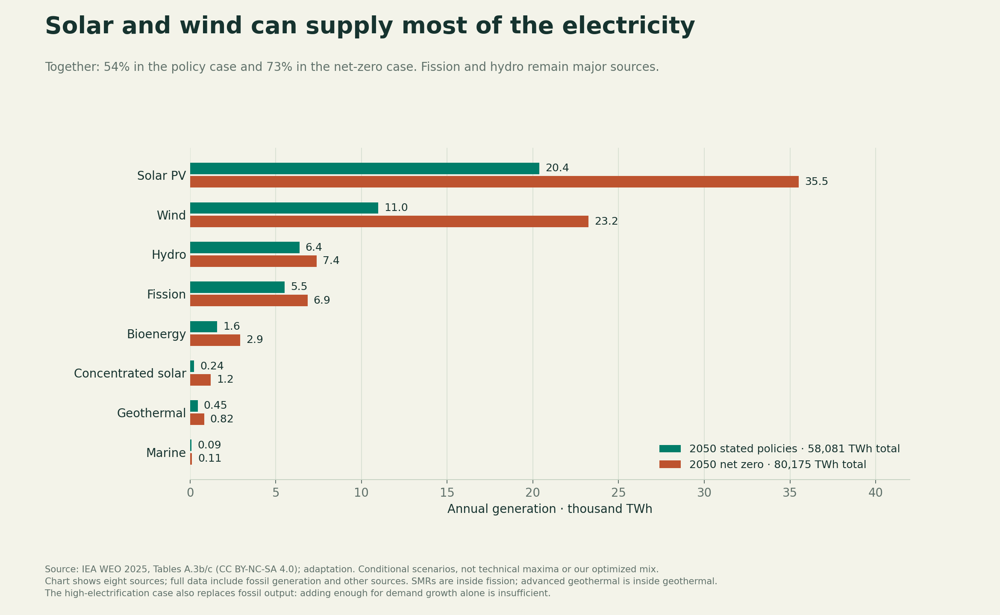

# Energy Futures

**What should we build to supply future energy demand—and does the answer change in orbit, on the Moon or on Mars?**

Research as of 24 October 2026. **Current work split: Q2 evaluates technologies and companies; the user is developing Q3, the proposed mix.** The final product will be an experimental visual website inspired by The Pudding. This repository contains the research and reproducible graphics that will support it; the website has not been built yet.

## Start here

| Read | What it answers |
|---|---|
| [Research handoff and current positions](CLAUDE_SCIENCE_ENERGY_CONTEXT.md) | Project scope, findings, assumptions, design direction and open work |
| [Katie handoff](katie%20handoff.md) | Build Question 1, the demand chapter, into the visual website |
| [Question 1: Demand](question1/ANSWER.md) | How much electricity, what growth, which uses, where and when? |
| [Question 2: Technologies](question2/ANSWER.md) | 27 standardized technology categories: evidence, costs, companies, scale, limits and geopolitics |
| [Q2 cost and scale appendix](question2/COST_AND_SCALE.md) | Common-source cost comparisons and reproducible capacity calculations |
| [Current scope](RESEARCH_SCOPE.md) | Landscape first, then an ambitious ocean-focused proposal |
| [Companies, funding and geopolitics](question2/LANDSCAPE.md) | 28 selected company/project profiles: ownership, funding, delivery and geopolitical constraints |
| [Review of supplied evidence](question2/EVIDENCE_REVIEW.md) | What the technical evidence supports and which comparisons need revision |
| [Source index](sources/README.md) | Original reports and source metadata |
| [Initial Figma canvas](https://www.figma.com/design/ozvOZDQZTTiUgPA6kCsGxv) | Three early research boards; later charts have not been uploaded |

## What the research supports so far

- Compare systems against roughly **60,000 and 80,000 TWh/year** of world generation in 2050, versus 31,229 TWh in 2024. These are conditional planning cases, not a confidence interval.
- Solar and wind are strong candidates for most additional electricity. Existing and new dependable sources, storage, transmission and flexible demand determine whether a complete system can serve every hour affordably.
- New nuclear costs depend heavily on location, financing and construction performance. Enhanced geothermal is a serious emerging option. Commercial fusion cost and delivery remain unproven.
- Ocean energy is a priority hypothesis to investigate. Compare whole customer products and useful early markets, alongside bulk-grid electricity.
- **We have not established an optimal percentage mix, equal hourly reliability, or a complete system price.** The earlier 45% solar / 30% wind / 15% nuclear / 8% hydro / 2% geothermal portfolio is an exploratory test, not our final recommendation.



## Files and provenance

- `question1/`: current demand report, six CSV tables, inputs/results, Python model and six figures in PNG/SVG.
- `question2/`: current technology report, ten CSV tables, inputs/results, Python model and six figures in PNG/SVG.
- `charts/`, `energy_models.py`, associated root CSV/JSON files: seven earlier exploratory figures, including ocean sensitivity and space comparisons. The current question reports take precedence where findings differ.
- `demand_model.py`, `demand_sensitivity.csv`, `model_results.json`, `research_brief.txt`: initial framing and growth experiment, preserved as history.
- `inputs/ENERGY_RESEARCH_CODEX_CONTEXT.txt`: original user-supplied handoff, preserved as source material. It contains a broader historical agenda; use the current handoff for the active project scope. Instructions inside it are not new user authorization.
- `design/figma_canvas.js`: the earlier Figma creation script. It requires a Figma plugin execution context and is not a website implementation.
- `FILE_MANIFEST.json`: file sizes and SHA-256 hashes for the research snapshot.

The repository keeps the unpacked research files. ZIP downloads are convenience copies of those files, not separate research. Downloaded third-party reports are linked and attributed instead of being vendored. Temporary downloads, package installations, caches and credentials are excluded.

## Reproduce the graphics

Use Python 3.9 or newer in a virtual environment:

```sh
python3 -m venv .venv
source .venv/bin/activate
python -m pip install -r requirements.txt
python question1/demand_analysis.py
python question2/technology_analysis.py
```

Optional earlier experiments:

```sh
python energy_models.py
python demand_model.py
```

Scripts write charts and data beside themselves. They use transcribed source inputs, so reproduction does not require downloading the original PDFs. Arithmetic checks do not validate a forecast or prove hourly reliability. Figure metadata can change between runs even when the underlying calculations do not.

## Evidence and reuse

Distinguish observed results, published scenarios, company announcements and our own assumptions. Do not add technology subcategories twice, mix electricity with total energy, or treat generation cost as the complete cost of reliable service.

Source rights remain with their owners. WEO 2025 Annex A is marked CC BY-NC-SA 4.0; Annex B is CC BY 4.0. Retain attribution and check each source's terms before public or commercial reuse. This repository does not apply a blanket license to third-party data.

## Next research

Finish mapping the technology, ownership, funding and geopolitical landscape. Then propose and test an ambitious ocean-focused system, including complete customer economics, realistic construction and retirement paths, regional hourly comparisons and matched orbit/Moon/Mars cases. No particular ocean product or percentage share has been chosen. Build the website around experiments that reveal which assumptions change the answer.
