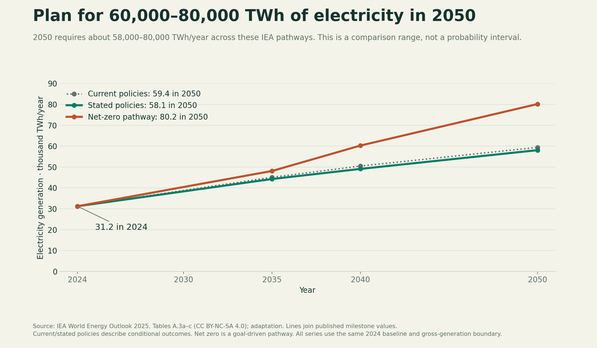
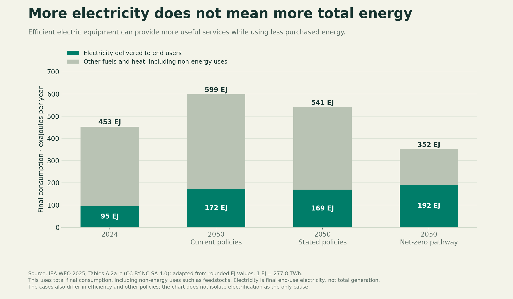
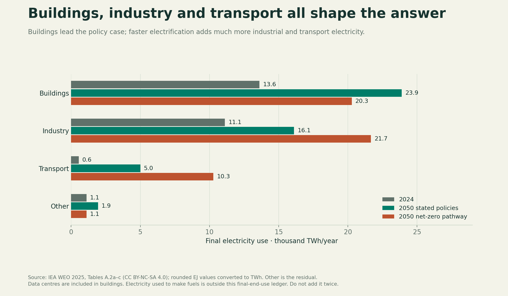
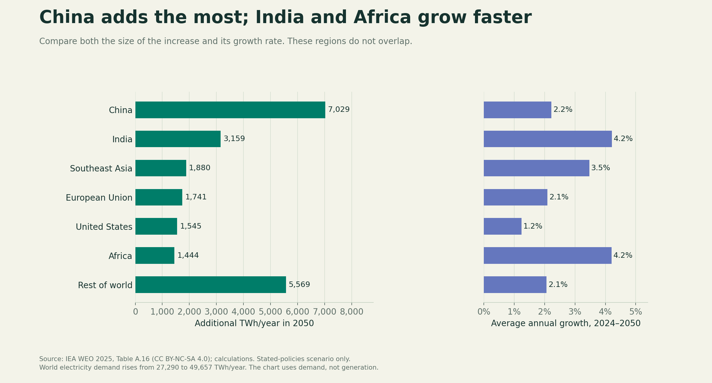
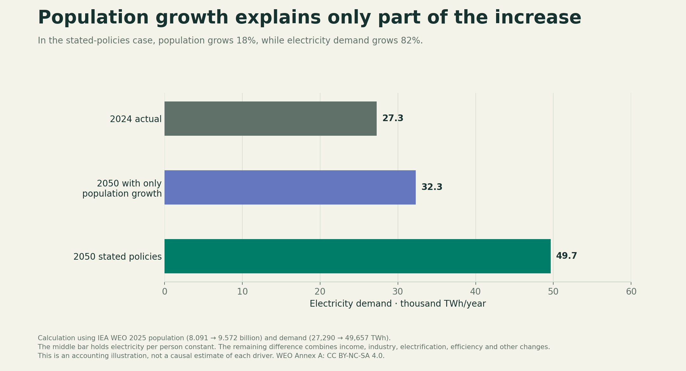
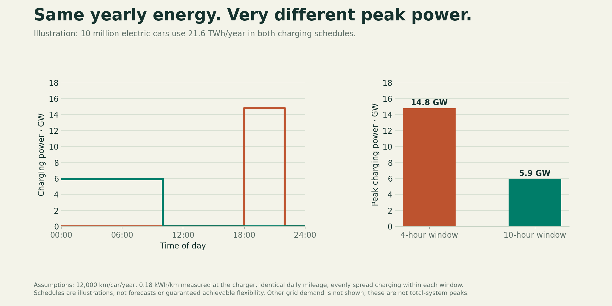

# How much energy will we need, where, and when?

24 October 2026

## Our answer

  **We should prepare for an electricity system producing roughly twice today's output by 2050, and test whether our proposed energy mix can support a more electrified world needing about two-and-a-half times today's output.**

For the next stage of this project, we use two grounded comparison cases:

- **Around 60,000 TWh of electricity generation per year in 2050:** the scale of the International Energy Agency's policy-led pathways.
- **Around 80,000 TWh per year:** the scale of its pathway to net-zero energy-sector emissions, with more electrification and production of fuels using electricity.

World generation was **31,229 TWh in 2024** in the same source. These are scenarios: they imply average generation growth of approximately **2.4–3.7% per year over 2024–2050**. Our recommendation is to test technologies against both cases; the exact supply required must eventually be recalculated for the losses and operating needs of our own mix. [IEA World Energy Outlook 2025, Tables A.3a–c](https://iea.blob.core.windows.net/assets/5306bae2-1f99-402f-8d14-542bfa0ae96e/WorldEnergyOutlook2025.pdf).

**The reason is broader than AI or population growth.** More people will use cooling, appliances, transport and manufactured goods; more existing activities will switch from fuels to electricity. Efficiency will reduce the energy needed for each service. Where and when that electricity is needed matters as much as the annual total.



## 1. What is the demand number?

“Energy” can mean several different quantities.

| Quantity | What it measures | How we should use it |
|---|---|---|
| Useful services | Heating a room, moving a vehicle, producing steel | Establish what people and businesses need |
| Final consumption | Electricity, fuels and heat supplied to end users | Track how the service is supplied |
| Electricity demand | Electricity consumed, including the specified energy-sector uses | Size electrical demand by region and hour |
| Electricity generation | Output from power plants before relevant own-use and losses | Estimate the supply system's required production |
| Primary energy | Energy entering the system before conversion | Account for resources and conversion; do not equate it to electricity needed |

Today much fuel energy becomes waste heat. Replacing an engine or boiler with electric equipment changes that calculation. For example, **100 TWh of useful heat** requires **111 TWh of gas** from an assumed 90%-efficient boiler, or **33 TWh of electricity** from an assumed heat pump delivering three units of heat per unit of electricity. The heating service is unchanged; purchased energy falls while electricity demand rises. This is an illustrative calculation, not a measured world average. The upstream electricity supply still has to be counted.

This is why “energy demand will double” is too imprecise. Electricity can grow strongly even while total energy consumption falls. [IEA Electrification, definitions on p. 29](https://iea.blob.core.windows.net/assets/1c696cc3-e251-46a9-8d4d-9edb2a4e806a/Electrification.pdf).

## 2. How fast is demand growing?

The short-term evidence and long-term pathways answer different questions:

| Measure | Result | Period and source |
|---|---:|---|
| Total global energy demand growth | 1.3% | 2025, IEA Global Energy Review 2026 |
| Electricity consumption | 28,600 TWh | 2025 estimate, IEA July 2026 update |
| Electricity demand growth | 3.6%, then 3.8% | Forecasts for 2026 and 2027, July update |
| Electricity consumption | About 30,700 TWh | 2027 forecast, July update |
| Electricity consumption | About 33,600 TWh | 2030 forecast, February 2026 edition |
| Added electricity demand each year | About 925 TWh | 2025–2035 stated-policies case, September 2026 report |
| Added electricity demand each year | Nearly 1,400 TWh | 2025–2035 high-electrification case, September report |

Sources: [Global Energy Review 2026](https://www.iea.org/reports/global-energy-review-2026/key-findings), [Electricity Mid-Year Update 2026](https://www.iea.org/reports/electricity-mid-year-update-2026/executive-summary), [Electricity 2026 demand chapter](https://www.iea.org/reports/electricity-2026/demand), [Electrification, pp. 50–51](https://iea.blob.core.windows.net/assets/1c696cc3-e251-46a9-8d4d-9edb2a4e806a/Electrification.pdf).

**Use roughly 3–4% as a near-term electricity growth description** Over decades, efficiency, adoption rates, economic growth and the choice to make fuels with electricity change the rate. Compounding today's rate indefinitely would hide those drivers.

The 2030 figure uses February's 2025 baseline of 28,200 TWh; July revised that baseline to 28,600 TWh. We preserve each published series instead of silently attaching the old forecast to the new baseline. Likewise, we do not join the revised 2025 estimate to the older WEO 2024 number and call the difference measured annual growth.

## 3. What do the longer-term numbers actually say?

The table below uses **one edition and one generation definition** throughout:

| Annual generation, TWh | 2024 | 2035 | 2040 | 2050 | Average annual growth, 2024–2050 |
|---|---:|---:|---:|---:|---:|
| Stated policies | 31,229 | 44,274 | 49,114 | 58,081 | 2.42% |
| Current policies | 31,229 | 45,109 | 50,488 | 59,426 | 2.51% |
| Net-zero pathway | 31,229 | 48,118 | 60,301 | 80,175 | 3.69% |

“Current policies” uses measures already in force. “Stated policies” includes a broader assessment of announced policy direction. “Net zero” works toward an emissions goal. It is not the agency's assertion that this outcome is most likely. The annual rates above are our calculations from the endpoints. [IEA WEO 2025, Annex A and scenario definitions](https://iea.blob.core.windows.net/assets/5306bae2-1f99-402f-8d14-542bfa0ae96e/WorldEnergyOutlook2025.pdf).

An independent check points in the same broad direction: **DNV's 2026 outlook projects electricity demand growing 80% by 2050**. Its public summary supports substantial growth, but we have not obtained and reconciled its full data definitions. We therefore do not average its forecast into an apparently precise “consensus” or convert its percentage into an unsupported absolute total. [DNV Energy Transition Outlook 2026](https://www.dnv.com/energy-transition-outlook/2026/).

Total final consumption follows a different path: the WEO's rounded figures move from **453 EJ in 2024** to **599 EJ under current policies, 541 EJ under stated policies, or 352 EJ in the net-zero pathway**. That corresponds to about +1.1%, +0.7% or −1.0% annual growth. The cases also differ in efficiency and other policies; this is not an experiment isolating electrification alone.



## 4. What will use the additional electricity?

**Buildings, industry and transport all matter.** They need different kinds of service and will create different load patterns.

| Use | What changes demand | What our later model must measure |
|---|---|---|
| Buildings | More cooling and appliances; changing floor area; electric heating/cooking; digital services | Equipment stock, use, weather and efficiency |
| Industry | More production; changes in what is produced; electric motors and process heat | Tonnes or other units of production, energy per unit, and electricity share |
| Transport | More travel and freight; replacement of fuel-powered vehicles | Vehicle stock, distance travelled, efficiency and charging times |
| Fuel production | Electricity used to make hydrogen and synthetic fuels | Quantity produced and electricity per unit; keep it separate from final-use electricity |
| Other uses | Agriculture, pumping and other activities | Their own activity and efficiency assumptions |

For a consistent long-term comparison, WEO's rounded final-electricity figures give:

| Final electricity use | 2024 | 2050 stated policies | 2050 net-zero pathway |
|---|---:|---:|---:|
| Buildings | 13,600 TWh | 23,900 TWh | 20,300 TWh |
| Industry | 11,100 TWh | 16,100 TWh | 21,700 TWh |
| Transport | 600 TWh | 5,000 TWh | 10,300 TWh |
| Other, residual | 1,100 TWh | 1,900 TWh | 1,100 TWh |
| Total, before rounding individual rows | 26,400 TWh | 46,900 TWh | 53,300 TWh |

These are converted from rounded EJ values, so apparent precision would be misleading. They are **final electricity**, not total generation or the broader electricity-demand series. Electricity used to manufacture fuels and other energy-sector uses belongs elsewhere in the balance. [IEA WEO 2025, Tables A.2b–c](https://iea.blob.core.windows.net/assets/5306bae2-1f99-402f-8d14-542bfa0ae96e/WorldEnergyOutlook2025.pdf).



In the policy case, buildings contribute about half of the increase in final electricity use through 2050. In the net-zero case, industry and transport together contribute about three-quarters of the increase. Those are our calculations from the rounded sector totals. **The choices we make about electrification change the demand we are trying to supply.**

Data centres should be visible, but counted inside the totals. The IEA's updated 2026 assessment puts their consumption at **485 TWh in 2025** and projects **950 TWh in 2030**, around 3% of world electricity demand then. Their local impact can be much larger than their global share. “Data centres,” “AI” and “buildings” are overlapping categories, not three loads to add together. [IEA Key Questions on Energy and AI](https://www.iea.org/reports/key-questions-on-energy-and-ai/executive-summary%C2%A0).

## 5. Where will growth occur?

Using the WEO stated-policies case, world electricity demand grows by **22,367 TWh/year between 2024 and 2050**. China, India and Southeast Asia together account for approximately **54%** of that increase. China adds the most because its existing system is large; India and Africa have faster percentage growth.

| Region | 2024 demand | 2050 demand | Added TWh/year | Average annual growth |
|---|---:|---:|---:|---:|
| China | 9,102 | 16,131 | 7,029 | 2.2% |
| India | 1,644 | 4,803 | 3,159 | 4.2% |
| Southeast Asia | 1,317 | 3,197 | 1,880 | 3.5% |
| European Union | 2,437 | 4,178 | 1,741 | 2.1% |
| United States | 4,102 | 5,647 | 1,545 | 1.2% |
| Africa | 753 | 2,197 | 1,444 | 4.2% |
| Rest of world | 7,935 | 13,504 | 5,569 | 2.1% |

All demand values are TWh/year. Regions do not overlap. Rates are calculated from the endpoints; they are not necessarily the rate in each individual year. [IEA WEO 2025, Table A.16](https://iea.blob.core.windows.net/assets/5306bae2-1f99-402f-8d14-542bfa0ae96e/WorldEnergyOutlook2025.pdf).



**The implication for our project:** one global energy mix is not enough. We need to assess supply options in the places where demand is growing, with local seasons, weather, industrial uses and connections. An abundant resource far from the customer is not yet delivered electricity.

## 6. Is population the main explanation?

It is only part of the explanation. In the same IEA case, population rises from **8.091 billion to 9.572 billion**, about **18%**, while electricity demand rises **82%**.

If electricity per person stayed constant, population growth would increase world demand from 27,290 to about **32,285 TWh/year**. The scenario instead reaches **49,657 TWh/year**. The remaining difference—about **17,372 TWh/year**—combines changing living standards, industry, electrification, efficiency and other factors. This is an accounting illustration, not a causal allocation among those drivers.

Electricity use per person rises from about **3,370 to 5,190 kWh/year** in this case. That includes economic activity, not just household consumption. Calculations use [WEO Tables A.5b and A.16](https://iea.blob.core.windows.net/assets/5306bae2-1f99-402f-8d14-542bfa0ae96e/WorldEnergyOutlook2025.pdf).



## 7. When will the power be needed?

An annual total cannot tell us whether we can keep equipment running at a particular hour. Cooling responds to heatwaves; heating responds to winter conditions; factories have production schedules; vehicle charging can sometimes move within a time window.

The IEA projects the **sum of electricity-system peaks** to increase roughly **40% by 2035**, from around 4,750 GW in 2024. This sums local systems' highest loads; it is not one simultaneous worldwide peak. [WEO 2025, pp. 240–241](https://iea.blob.core.windows.net/assets/5306bae2-1f99-402f-8d14-542bfa0ae96e/WorldEnergyOutlook2025.pdf).

Consider an explicit illustration: 10 million electric cars, each driven 12,000 km/year at 0.18 kWh/km measured at the charger. They require **21.6 TWh/year**. If identical daily charging is concentrated into four hours, this fleet adds **14.8 GW** during that window. Spreading it evenly across ten hours reduces that figure to **5.9 GW**, with exactly the same annual energy. Real schedules must respect when cars are connected and ready to travel, and the rest of grid demand must be included.



**Our supply comparison therefore needs two targets:** enough energy over the year, and enough available power at the difficult hours. Neither annual average output nor an annual surplus proves reliability.

## 8. What demand specification should we use next?

Use the following as the starting requirements for comparing technologies:

| Requirement | Starting specification |
|---|---|
| Scope | Earth first; global totals with regional demand |
| Near-term reference | Published 2030 electricity consumption near 34,000 TWh, with its February 2026 baseline clearly identified |
| Policy-led 2050 case | About 60,000 TWh/year generation, anchored to the 58,081–59,426 TWh published cases |
| More electrified 2050 case | About 80,000 TWh/year generation, anchored to the net-zero pathway |
| Intermediate generation checkpoints | About 44,000–48,000 TWh in 2035 and 49,000–60,000 TWh in 2040 across these pathways |
| Growth drivers | Industry, buildings, transport and fuel production, with efficiency and adoption explicit |
| Geographic priority | China, India, Southeast Asia, Africa, US and EU, plus a reconciled remainder |
| Timing | Regional hourly loads, seasonal patterns, extreme-weather cases and feasible load shifting |
| Treatment of uncertainty | Separate policy, faster electrification and higher/lower activity or efficiency cases; do not label them probabilities |

At the global level, the published generation cases imply average net additions of approximately **1,030–1,880 TWh of annual output per year** between 2024 and 2050. Replacing output lost when plants retire increases the construction task. Converting these energy amounts into solar, wind, nuclear or other installed capacity belongs to the next question, because output per unit of capacity differs.

The upper case is not a ceiling. Large new uses or slower efficiency gains could require more; slower growth or better efficiency could require less. Greater electrification also changes fuel demand, so a complete recommendation must keep both electricity and remaining fuels/heat in its accounting.

## 9. What we now know—and what is still not solved

**The demand-side answer is strong enough to guide the next comparison:** plan for much more electricity, use roughly 60,000 and 80,000 TWh/year generation as grounded 2050 comparison cases, and treat location and timing as requirements. Do not build the argument around a single perpetual growth rate or a single new use such as AI.

The work completed here is a sourced scenario comparison and a set of reproducible calculations. It is **not an independently calibrated forecast or an hourly power-system simulation**. It establishes a scale and explains the main drivers; it does not prove a supply mix can serve them.

The next demand-model improvement should follow this structure:

```text
For each region and end use:
activity × energy per unit of activity × technology adoption
    → electricity, fuel and heat requirements
    → hourly demand shaped by weather and operating schedules

Then calculate required generation for the proposed supply system,
including its own losses, energy-sector uses, storage and unused output.
```

Examples of activity are vehicle-kilometres, floor area and tonnes of material produced. Equipment efficiency belongs in energy per unit; electric vehicle and heat pump adoption changes the energy carrier. Calibrate on compatible historical data, test against held-out years, and keep records of errors and revisions. We have not performed that full calibration yet.

For the future website, the strongest first-chapter argument is: **“We need much more electricity. But how much depends on what we electrify—and how much energy we stop wasting.”** The growth, sector, population and charging comparisons above each support a reader experiment.

## Methods, source audit and files

- **Common long-term edition:** WEO 2025. Long-term plots use its 2024 baseline and milestone tables without substituting newer historical values.
- **Updated near term:** July 2026 electricity figures are kept separate from February's 2030 forecast. September's electrification report provides newer drivers and 2035 growth comparisons.
- **A resolved definition difference:** WEO total final consumption includes non-energy uses, such as feedstocks. The September report's total final **energy** consumption excludes those uses (p. 29). Its approximately 23% electricity share should not be treated as directly interchangeable with WEO's approximately 21% share.
- **Energy balance:** final electricity, electricity demand and generation are separate. Their gaps include more than transmission losses. The 60,000/80,000 TWh values are published-system benchmarks, not independent inputs that make any chosen mix feasible.
- **Sector precision:** rounded EJ figures are converted with 1 TWh = 0.0036 EJ. Residual categories and small shares should not be overinterpreted.
- **Growth calculation:** `(end/start)^(1/years) − 1`. Population and charging calculations use explicit assumptions in the script.
- **Independent forecast:** DNV's public overview was reviewed; its full data require a registration form and were not obtained. Its percentage is used as a directional cross-check only.
- **Checks performed:** sector sums, regional sums, scenario rows, unit conversions, and equal daily energy across charging schedules. Figures were rendered for visual review. These checks do not validate a future forecast.
- **Reuse:** IEA WEO Annex A is labeled CC BY-NC-SA 4.0. Other IEA material used here is labeled CC BY 4.0. Retain attribution and review terms for the eventual website.

Companion files: `demand_analysis.py`, `demand_results.json`, six CSV datasets, and six figures in PNG and SVG. Running the script with Python, numpy and matplotlib reproduces the calculations and figures.
