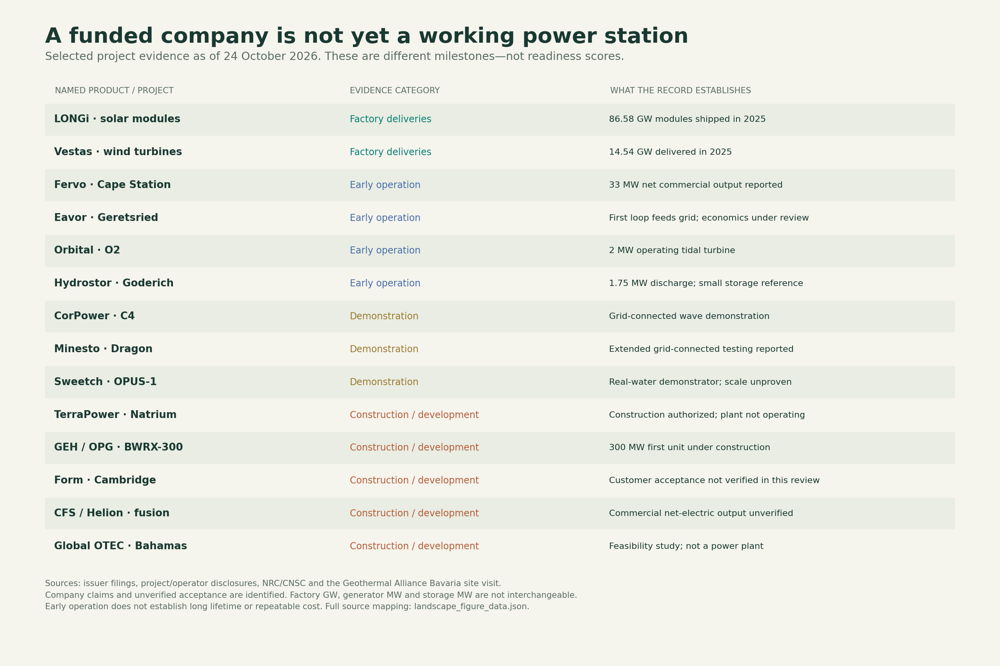
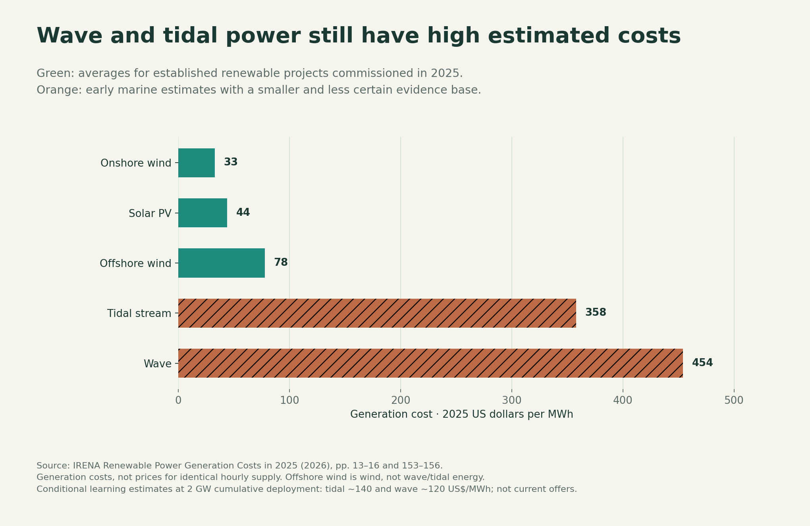
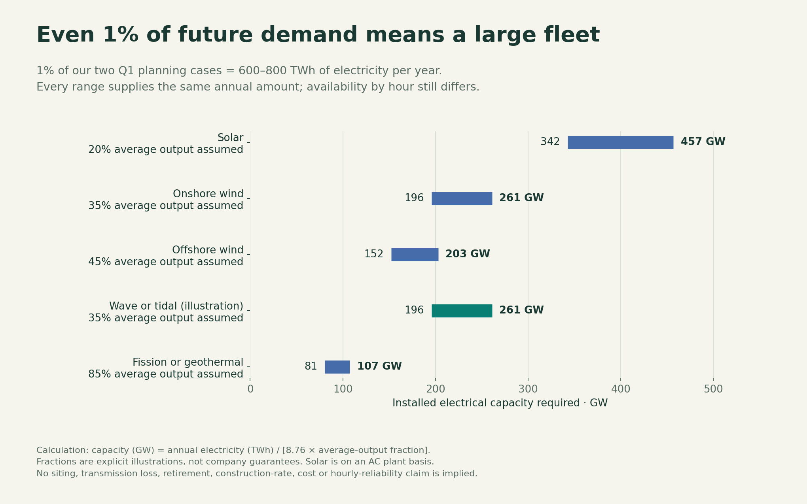

# Q2 — Evaluate the energy technologies

**What can each technology supply, who is building it, what does it cost, and what still has to work?**

Research cut-off: **24 October 2026**. This is the technology assessment. **The user is developing Q3, the proposed mix.** No portfolio percentages are recommended here. Earth electricity is the main comparison; industrial heat, storage and fuels have their own service labels. The final project remains a visual website inspired by The Pudding.

## The answer in one minute

- **Solar, onshore wind, hydro and large fission already supply electricity at scale.** Their main questions concern local cost, construction, connections, operating performance and the timing of output.
- **Emerging technologies are at different stages.** Enhanced and closed-loop geothermal have early grid output; floating wind has operating arrays; selected small/advanced reactors are under construction. Those achievements do not yet establish cheap repeated fleets.
- **Fusion, ocean thermal, salinity power and wave-powered computing have larger gaps between their promise and verified commercial performance.** Wave and tidal electricity have real demonstrations and operating units; their main unresolved issue is repeatable cost and sustained delivery at much larger scale.
- **Storage and hydrogen are not additional energy sources.** Evaluate the service delivered, losses, duration and charging energy. Industrial heat storage must be compared in units of useful heat.
- **There is no honest single price for many emerging options.** “Not verified” is the finding where an operating commercial price has not been established—not an assumption of zero cost or technical failure.

These are our assessments of the evidence, not investment recommendations or a forecast of which company will win. The detailed records separate verified events, company reports, targets, models and our arithmetic.

## Read the comparison consistently

Every technology below uses the same eight fields: **output; evidence; companies/ownership/funding; cost; scale/timing; limitations; geopolitics; assessment.** Dollar values retain their stated geography, year and accounting boundary. US$100/MWh is 10 cents/kWh. A generation price does not purchase reliable electricity at every hour.

The company selection covers 28 manufacturers, developers and project groups chosen for relevant production, financing or operating evidence. It is **not an exhaustive global ranking**. Specific Chinese, European, North American, Korean and multinational examples are included; other important suppliers remain outside the detailed company audit. Public institutions and utilities also matter.

[Company-by-company records](LANDSCAPE.md) · [Detailed cost and scale calculations](COST_AND_SCALE.md) · [Methods and limits](METHODS.md) · [Review of the supplied evidence](EVIDENCE_REVIEW.md)

## What the evidence actually says

An operating demonstration proves more than an announcement, but less than a repeatable fleet with known lifetime costs. The labels describe the **named product or project**, not every technology a company develops. An empty commercial-cost field is not a readiness percentage.

## Cost comparison

Lazard’s US new-build comparison uses a common financing framework. Its US nuclear range reflects Vogtle; it is not a global nuclear price. Its coal and geothermal estimates have older inputs adjusted for inflation. The [cost appendix](COST_AND_SCALE.md) also gives global commissioned-project averages and regional nuclear assumptions.

This second chart deliberately distinguishes established-project averages from early marine estimates. It describes the current evidence; it is not a cost ranking for identical hourly service. Wave and tidal learning targets are conditional and appear in their records below.

## Potential contribution to demand

These are published **scenario outcomes, not technical ceilings**. Each share uses its own scenario’s demand total. Advanced geothermal, SMRs and tandem solar belong inside their parent categories. Do not add them a second time. Company pipelines do not establish guaranteed market share.

The 1% experiment is arithmetic with explicit average-output assumptions. It makes a proposed share concrete; it does not establish available sites, hourly reliability, cost or a feasible construction schedule.

## Technology index

Click a technology for its standardized evaluation. Expand only the records you need; the JSON files contain the same text for later website use.

| Technology | Service | Evidence stage |
|---|---|---|
| [Solar photovoltaics](#solar) | Generation | Commercial at scale |
| [Perovskite-silicon tandem solar](#tandem) | Generation | Early commercial shipments |
| [Onshore wind](#onshore) | Generation | Commercial at scale |
| [Fixed-bottom offshore wind](#offshore) | Generation | Commercial at scale |
| [Floating offshore wind](#floatingwind) | Generation | Early commercial arrays |
| [Hydropower and pumped storage](#hydro) | Generation / storage | Commercial at scale |
| [Large nuclear fission](#fission) | Generation | Commercial at scale; delivery varies |
| [Small light-water reactors](#smr) | Generation | Named Western design under construction |
| [Advanced fission: sodium and high-temperature designs](#advancedfission) | Generation / heat | Construction / pre-commercial development |
| [Fusion](#fusion) | Generation | No verified commercial net-electric plant in this review |
| [Conventional and enhanced geothermal](#geothermal) | Generation / heat | Conventional commercial; enhanced early commercial output |
| [Closed-loop geothermal](#closedloop) | Generation / heat | Early grid output |
| [Superhot geothermal and new drilling](#superhot) | Generation / heat | Drilling / project development |
| [Wave electricity exported to a grid](#wave) | Generation | Grid-connected demonstrations / small deployments |
| [Wave-powered offshore computing](#wavecompute) | Generation plus end-use service | Commercial system performance unverified |
| [Tidal-stream turbines and kites](#tidalstream) | Generation | Operating turbines / small arrays |
| [Tidal range: barrages and lagoons](#tidalrange) | Generation | Operating large reference plants |
| [Ocean thermal energy conversion](#otec) | Generation, potentially water/cooling | Small demonstrations; larger projects in development |
| [Salinity-gradient power](#salinity) | Generation | Operating demonstrator |
| [Lithium-ion and sodium-ion batteries](#batteries) | Storage | Lithium-ion commercial at scale; sodium-ion earlier |
| [Iron-air multi-day batteries](#ironair) | Storage | Early deployments; acceptance evidence incomplete |
| [Compressed-air and flow-battery storage](#mechanical) | Storage | Operating references; scale and economics vary |
| [Industrial heat storage](#heatstorage) | Storage / industrial heat | Early commercial industrial units |
| [Hydrogen and ammonia from electricity](#hydrogen) | Energy carrier / feedstock | Commercial components; large clean-fuel projects scaling |
| [Gas, coal and carbon capture](#ccs) | Generation | Fossil generation mature; integrated capture less widespread |
| [Bioenergy and concentrated solar power](#other) | Generation / heat | Commercial, resource-specific |
| [Solar power in space](#space) | Generation in orbit / transmission to Earth | Orbital solar established; large Earth-delivery system unproven |

<strong>Solar photovoltaics</strong> — Commercial at scale

| Evaluation field | Finding |
|---|---|
| **What it supplies** | Converts sunlight directly to electricity. Silicon and cadmium-telluride are established products. |
| **Evidence and stage** | Large factories and operating fleets. LONGi reports 86.58 GW of modules shipped in 2025; First Solar reports 17.5 GW sold. These are manufacturer DC module figures, not measured electricity or AC plant capacity. |
| **Companies, owners and funding** | LONGi: public, founder-controlled in its June 2026 filing; sales and debt finance factories. First Solar: public shareholders; sales, corporate capital and US manufacturing credits. Plant developers raise separate project capital. |
| **Cost and its basis** | US$44/MWh: global average estimate for projects commissioned in 2025. US$40–98/MWh: modeled US new builds in 2026. Generation only; not all-hours supply. |
| **Demand contribution and timing** | IEA 2050 scenarios: 20,374–35,509 TWh/year, or 35.1–44.3% of each scenario total. Main near-term growth option, subject to connections and demand at generating hours. |
| **Main limitations** | Night, seasonal variation, midday surplus, land/roofs, transmission and financing. More panel efficiency does not remove these constraints. |
| **Geopolitical effect** | China-centered supply chains make tariffs, import restrictions and local manufacturing policy economically important. |
| **Assessment / next proof** | Very strong evidence of scalable generation. Compare delivered local projects and hourly value, not just module efficiency. |

Sources: [LONGi 2025 results](https://www.longi.com/en/news/annual-report-2025/); [First Solar 2025 annual report](https://www.sec.gov/Archives/edgar/data/1274494/000127449426000098/fslr2025annualreportpdf.pdf); [LONGi 2026 interim report, p. 243](https://static.longi.com/LON_Gi_Interim_Report_2026_7690cedede.pdf); [IRENA renewable power generation costs in 2025](https://www.irena.org/Publications/2026/Jul/Renewable-Power-Generation-Costs-in-2025); [Lazard LCOE+ v19, p. 7](https://www.lazard.com/media/kcfconhf/lazards-lcoeplus_vf.pdf); [IEA WEO 2025, Annex A and B](https://iea.blob.core.windows.net/assets/5306bae2-1f99-402f-8d14-542bfa0ae96e/WorldEnergyOutlook2025.pdf); [IEA manufacturing concentration and trade](https://www.iea.org/reports/energy-technology-perspectives-2026/supply-chain-risks-and-industrial-competitiveness)

<strong>Perovskite-silicon tandem solar</strong> — Early commercial shipments

| Evaluation field | Finding |
|---|---|
| **What it supplies** | Adds a second light-absorbing layer to capture more energy per unit area. |
| **Evidence and stage** | Oxford PV reported first commercial shipment in 2024. A laboratory cell record, factory module result and multi-year field performance are different evidence. |
| **Companies, owners and funding** | Oxford PV is private; historical backers include Goldwind, Equinor and Legal & General. Exact current control was not verified. LONGi also pursues higher-efficiency solar; that does not make all its output tandem. |
| **Cost and its basis** | No independently established commercial fleet electricity cost. Higher efficiency helps only if price, yield and lifetime preserve the gain. |
| **Demand contribution and timing** | Potentially increases solar output where land or installation cost matters. Included within the solar scenario totals; no separate verified 2050 share. |
| **Main limitations** | Outdoor degradation, moisture/heat, encapsulation, large-area manufacturing yield and warranty backing. |
| **Geopolitical effect** | European R&D/manufacturing and international intellectual property compete with established Asian scale. |
| **Assessment / next proof** | Credible solar improvement to track. Require full-module lifetime and cost evidence before claiming a system-wide breakthrough. |

Sources: [Oxford PV first commercial shipment](https://www.oxfordpv.com/press-releases/oxford-pv-solar-technology-patent); [Oxford PV historical financing](https://www.alexa-capital.com/engagements/oxford-pv); [Oxford PV board and company](https://www.oxfordpv.com/about-us)

<strong>Onshore wind</strong> — Commercial at scale

| Evaluation field | Finding |
|---|---|
| **What it supplies** | Converts wind into electricity using land-based turbines. |
| **Evidence and stage** | Vestas reported 201 GW cumulatively installed by end-2025, across onshore and offshore models. Historical installations are not all necessarily still operating. |
| **Companies, owners and funding** | Vestas: listed, broadly held; sales, services and corporate finance. Other major suppliers include Chinese and European manufacturers; the detailed ledger does not claim an exhaustive supplier ranking. |
| **Cost and its basis** | US$33/MWh global commissioned-project average in 2025; US$37–99/MWh modeled US new builds in 2026. |
| **Demand contribution and timing** | IEA all-wind scenarios: 10,991–23,250 TWh/year in 2050, 18.9–29.0% of respective totals. Do not allocate the full total separately to onshore and offshore wind. |
| **Main limitations** | Wind variation, land access, permitting, transmission, turbine reliability and maintenance. |
| **Geopolitical effect** | Local-content rules, trade restrictions and manufacturing location change project bids and eligibility. |
| **Assessment / next proof** | A strong low-cost generation benchmark. Evaluate regional wind resource and production timing alongside buildability. |

Sources: [Vestas annual report 2025, pp. 27 and 43](https://www.vestas.com/content/dam/vestas-com/global/en/investor/reports-and-presentations/financial/2025/fy-2025/Vestas%20Annual%20Report%202025.pdf); [IRENA renewable power generation costs in 2025](https://www.irena.org/Publications/2026/Jul/Renewable-Power-Generation-Costs-in-2025); [Lazard LCOE+ v19, p. 7](https://www.lazard.com/media/kcfconhf/lazards-lcoeplus_vf.pdf); [IEA WEO 2025, Annex A and B](https://iea.blob.core.windows.net/assets/5306bae2-1f99-402f-8d14-542bfa0ae96e/WorldEnergyOutlook2025.pdf)

<strong>Fixed-bottom offshore wind</strong> — Commercial at scale

| Evaluation field | Finding |
|---|---|
| **What it supplies** | Wind turbines anchored to the seabed; an ocean-sited wind technology, distinct from wave and tidal energy. |
| **Evidence and stage** | Commercial offshore turbines and fleets exist; new projects still carry installation and repair risk. |
| **Companies, owners and funding** | Vestas is a detailed supplier example. Developers, utilities and infrastructure investors finance individual farms separately from turbine manufacturers. |
| **Cost and its basis** | US$78/MWh global 2025 commissioned-project average; US$105–167/MWh modeled US 2026 projects. Geographic and financial differences explain part of the gap. |
| **Demand contribution and timing** | Part of the all-wind 2050 totals. Can serve large coastal demand, with build rates limited by ports, vessels, cables and connections. |
| **Main limitations** | Marine construction, access in poor weather, seabed conditions, cable failures and financing. |
| **Geopolitical effect** | Seabed leasing, national procurement and industrial policy strongly affect whether projects proceed. |
| **Assessment / next proof** | Established generation with more demanding construction economics than onshore wind. Use local bids; do not transfer its cost to floating wind. |

Sources: [Vestas annual report 2025, pp. 27 and 43](https://www.vestas.com/content/dam/vestas-com/global/en/investor/reports-and-presentations/financial/2025/fy-2025/Vestas%20Annual%20Report%202025.pdf); [IRENA renewable power generation costs in 2025](https://www.irena.org/Publications/2026/Jul/Renewable-Power-Generation-Costs-in-2025); [Lazard LCOE+ v19, p. 7](https://www.lazard.com/media/kcfconhf/lazards-lcoeplus_vf.pdf); [IEA WEO 2025, Annex A and B](https://iea.blob.core.windows.net/assets/5306bae2-1f99-402f-8d14-542bfa0ae96e/WorldEnergyOutlook2025.pdf)

<strong>Floating offshore wind</strong> — Early commercial arrays

| Evaluation field | Finding |
|---|---|
| **What it supplies** | Places wind turbines on floating foundations moored in deep water. |
| **Evidence and stage** | Hywind Tampen operates with 11 turbines, 94.6 MW combined turbine rating. Operator notes export infrastructure was not upgraded with the turbines. |
| **Companies, owners and funding** | Equinor: 67% Norwegian state-owned listed company; project partners and historical Enova support. State ownership, project subsidy and project ownership are distinct. |
| **Cost and its basis** | No standardized repeat-project cost verified in this review. Fixed-bottom/global offshore averages are comparators, not floating-wind quotations. |
| **Demand contribution and timing** | Potential access to deep-water wind near coastal loads. Still a small operating base relative to established wind; no separate forecast assigned. |
| **Main limitations** | Floating foundations, moorings, dynamic cables, ports, towing/repair and financial risk. |
| **Geopolitical effect** | Countries with deep coastlines and offshore industrial capability may support early projects; seabed and environmental permissions remain local. |
| **Assessment / next proof** | Technically demonstrated at array scale. Repeated construction and maintenance costs are the main commercial test. |

Sources: [Hywind Tampen project](https://www.equinor.com/energy/hywind-tampen); [Equinor shareholders](https://www.equinor.com/investors/our-shareholders); [Norway industrial initiative, p. 71](https://www.regjeringen.no/contentassets/1c3d3319e6a946f2b57633c0c5fcc25b/roadmap_the-green-industrial-initiative_singlepages_web.pdf); [IRENA renewable power generation costs in 2025](https://www.irena.org/Publications/2026/Jul/Renewable-Power-Generation-Costs-in-2025)

<strong>Hydropower and pumped storage</strong> — Commercial at scale

| Evaluation field | Finding |
|---|---|
| **What it supplies** | Natural river inflow supplies hydro generation. Pumped storage moves previously generated electricity through a water cycle and consumes net energy. |
| **Evidence and stage** | Large global operating fleets; reservoirs can shift output, subject to water availability and operating rules. |
| **Companies, owners and funding** | Examples include utility/public operators such as EDF and K-water. Ownership and funding are typically project-specific public or utility capital plus debt. |
| **Cost and its basis** | Conventional hydro: US$62/MWh global 2025 commissioned-project average. This is not a cost for every dam or pumped-storage discharge. |
| **Demand contribution and timing** | IEA hydro generation: 6,383–7,398 TWh/year in 2050, 11.0–9.2% of respective scenarios. Do not add pumped-storage output as new primary energy. |
| **Main limitations** | Geography, drought, competing water uses, ecosystems, displacement and civil works. |
| **Geopolitical effect** | Transboundary river agreements and public investment shape access and operation. |
| **Assessment / next proof** | Important established benchmark; expansion is site-constrained. Evaluate natural inflow and storage services separately. |

Sources: [IRENA renewable power generation costs in 2025](https://www.irena.org/Publications/2026/Jul/Renewable-Power-Generation-Costs-in-2025); [IEA WEO 2025, Annex A and B](https://iea.blob.core.windows.net/assets/5306bae2-1f99-402f-8d14-542bfa0ae96e/WorldEnergyOutlook2025.pdf); [EDF 2025 registration document](https://www.edf.fr/sites/groupe/files/2026-04/2026-04-02-urd-edf-2025-en.pdf); [K-water Sihwa project](https://www.kwater.or.kr/eng/busi/project03Page.do?s_mid=1192)

<strong>Large nuclear fission</strong> — Commercial at scale; delivery varies

| Evaluation field | Finding |
|---|---|
| **What it supplies** | Splits atomic nuclei to provide heat, usually producing electricity through steam turbines. |
| **Evidence and stage** | Long operating record. KHNP/KEPCO’s four Barakah units entered service in 2021–24. New construction performance varies strongly across countries and projects. |
| **Companies, owners and funding** | Westinghouse: Brookfield 51%, Cameco 49%. EDF: French state. KHNP: KEPCO subsidiary. Utilities/governments finance plants; reactor suppliers are not automatically plant owners. |
| **Cost and its basis** | US$175–255/MWh modeled new US nuclear based on Vogtle. IEA repeat-build 2024 assumptions: China 70, India 75, US 110, EU 165 US$/MWh. Existing plant operating costs are a separate category. |
| **Demand contribution and timing** | IEA total fission, including SMRs: 5,531–6,853 TWh/year in 2050, 9.5–8.5%. New builds and retaining existing plants both affect supply. |
| **Main limitations** | Upfront capital, long construction, outages, workforce/components, fuel, cooling and waste provisions. |
| **Geopolitical effect** | Government finance, export agreements and fuel suppliers shape costs and schedules; national industry matters as much as reactor design. |
| **Assessment / next proof** | Proven large-scale generation. Evaluate the actual builder, country, finance and completed cost before comparing economics. |

Sources: [Cameco: Westinghouse ownership](https://www.cameco.com/businesses/westinghouse-nuclear); [French state becomes sole EDF shareholder](https://presse.economie.gouv.fr/08062023-letat-redevient-lactionnaire-unique-dedf/); [KEPCO subsidiaries: KHNP 100%](https://www.kepco.co.kr/home/about/orgaznization/subsidiaries/group-company/conts.do); [KHNP Barakah operating milestones](https://www.khnp.co.kr/eng/contents.do?key=560); [Lazard LCOE+ v19, p. 7](https://www.lazard.com/media/kcfconhf/lazards-lcoeplus_vf.pdf); [IEA WEO 2025, Annex A and B](https://iea.blob.core.windows.net/assets/5306bae2-1f99-402f-8d14-542bfa0ae96e/WorldEnergyOutlook2025.pdf)

<strong>Small light-water reactors</strong> — Named Western design under construction

| Evaluation field | Finding |
|---|---|
| **What it supplies** | Smaller reactors using familiar water-cooled technology, with a proposed path to repeated manufacture. |
| **Evidence and stage** | GE Vernova Hitachi’s 300 MW BWRX-300 at Darlington is under construction. Regulatory approval to construct is not permission to operate or proof of fleet cost. |
| **Companies, owners and funding** | US technology venture: GE Vernova 60%, Hitachi 40%. OPG owns Darlington and finances the project; technology supplier and plant owner differ. |
| **Cost and its basis** | OPG first-unit budget C$7.7bn includes shared infrastructure, interest, contingency and escalation. Equivalent C$25,700/kW is not an overnight or repeated-unit price. |
| **Demand contribution and timing** | IEA broad SMR cases: 40–190 GW in 2050; at our assumed 85% output, 298–1,415 TWh/year. These are subsets of fission, not extra output to add. |
| **Main limitations** | First-build cost, licensing, manufacturing orders and economies of repetition. Smaller size alone does not guarantee cheap electricity. |
| **Geopolitical effect** | Public procurement can establish first orders; supply-chain localization and licensing differ by market. |
| **Assessment / next proof** | Concrete construction evidence makes this a serious option. The key economic test is the cost of successive completed units. |

Sources: [Hitachi: US and Japanese nuclear venture ownership](https://www.hitachi.com/en/press/articles/2025/10/1028b/); [OPG 2025 financial report: Darlington project budget](https://www.opg.com/wp-content/uploads/2026/03/2025-Q4-OPG-PR-MDA-FS-FINAL.pdf); [CNSC Darlington project record](https://www.cnsc-ccsn.gc.ca/eng/reactors/new-reactor-power-plant-projects/new-reactor-power-plant-facilities/darlington-new-nuclear-project/); [IEA small reactor scenarios](https://www.iea.org/reports/the-path-to-a-new-era-for-nuclear-energy/executive-summary)

<strong>Advanced fission: sodium and high-temperature designs</strong> — Construction / pre-commercial development

| Evaluation field | Finding |
|---|---|
| **What it supplies** | Uses different coolants, fuels or heat delivery. TerraPower Natrium and X-energy Xe-100 are different designs, not interchangeable products. |
| **Evidence and stage** | TerraPower received NRC construction authorization in March 2026 and announced plant construction in April. No operating commercial Xe-100 fleet verified here. |
| **Companies, owners and funding** | TerraPower: private, Gates-founded, US$650m 2025 equity round. X-energy: public since April 2026, about US$1.1bn net IPO proceeds; Amazon earlier investor/customer. Exact current private control unknown. |
| **Cost and its basis** | No completed commercial price for these designs. Do not turn funding rounds or proposed contract prices into verified production costs. |
| **Demand contribution and timing** | Natrium’s 345 MW reactor plus storage can vary delivery; temporary storage output is not extra reactor energy. Future output is inside fission scenarios. |
| **Main limitations** | HALEU and fuel fabrication for relevant designs, materials, first construction, maintenance and full plant licensing. |
| **Geopolitical effect** | US enrichment investment and industrial-policy support address supply risk; fuel availability remains design-specific. |
| **Assessment / next proof** | Potentially useful electricity and industrial heat, but cost and repeatability remain open. Track construction and fuel deliveries rather than announced pipeline alone. |

Sources: [TerraPower $650m financing](https://www.terrapower.com/terrapower-announces-650-million-fundraise); [NRC authorizes Kemmerer construction permit](https://content.govdelivery.com/accounts/USNRC/bulletins/40ca5a7?reqfrom=share); [TerraPower construction start](https://www.terrapower.com/TerraPower-Commences-Construction-on-Americas-First-Utility-Scale-Advanced-Nuclear-Power-Plant); [X-energy Q2 2026 results](https://investors.x-energy.com/news-releases/news-release-details/x-energy-reports-second-quarter-2026-results); [X-energy $700m Series C-1](https://x-energy.com/media/news-releases/x-energy-closes-upsized-700-million-series-c-1-financing-round-to-accelerate-the-development-of-advanced-small-modular-nuclear-technology); [DOE enrichment awards](https://www.energy.gov/articles/us-department-energy-awards-27-billion-restore-american-uranium-enrichment)

<strong>Fusion</strong> — No verified commercial net-electric plant in this review

| Evaluation field | Finding |
|---|---|
| **What it supplies** | Combines light nuclei; different companies pursue magnetic confinement, pulsed systems and other designs. |
| **Evidence and stage** | CFS SPARC and Helion’s machines address important technical steps. Plasma/target gain is not the electricity balance of an entire power station. |
| **Companies, owners and funding** | CFS: private, reports US$4bn cumulative funding after July 2026 round; Google and Eni are investors/buyers. Helion: private, US$500m Series G close reported September 2026, Thrive-led. |
| **Cost and its basis** | No verified commercial electricity price. Target prices lack an operating fleet basis. |
| **Demand contribution and timing** | CFS targets ~400 MW ARC early next decade; Helion targets ≥50 MW Orion from 2028. To supply 1% of 80,000 TWh/year at assumed 85% output requires ~107 GW, or ~269 plants of 400 MW. |
| **Main limitations** | Net electricity, repetition/duty cycle, materials life, maintainability and fuel cycle; tritium requirements differ by design. |
| **Geopolitical effect** | National R&D, specialized components, fuel and strategic power buyers can support development; they cannot establish performance. |
| **Assessment / next proof** | Potentially important later; present supply contribution cannot be inferred from fundraising or first-plant targets. Require sustained net electricity and credible repeat-plant cost. |

Sources: [CFS $1bn financing announcement](https://www.cfs.energy/news-and-media/commonwealth-fusion-systems-raises-another-1-billion-bringing-total-capital-raised-to-4-billion/); [CFS ARC power plant](https://www.cfs.energy/technology/arc/); [Helion Series G, updated final close](https://www.helionenergy.com/newsroom/helion-raises-465-million-series-g-funding-round-to-meet-surging-global-demand-for-power); [Helion Orion project](https://www.helionenergy.com/orion); [DOE fusion roadmap](https://www.energy.gov/articles/energy-department-releases-finalized-fusion-science-and-technology-roadmap-accelerate)

<strong>Conventional and enhanced geothermal</strong> — Conventional commercial; enhanced early commercial output

| Evaluation field | Finding |
|---|---|
| **What it supplies** | Uses underground heat. Conventional plants exploit suitable reservoirs; enhanced systems create or improve flow pathways. |
| **Evidence and stage** | Fervo reports first Cape Station unit operating at 33 MW net in October 2026. The full announced development was not all operating. |
| **Companies, owners and funding** | Fervo is public after May 2026 IPO; reports US$2.2bn gross IPO proceeds and US$421m project debt for first phase. Equity and debt are separate financing categories. |
| **Cost and its basis** | Conventional geothermal global 2025 average US$89/MWh. Do not label this a measured Fervo/EGS cost. IEA’s ~US$50/MWh by 2035 is a conditional improvement case. |
| **Demand contribution and timing** | IEA all-geothermal 2050 output 452–825 TWh. Separate next-generation study reaches nearly 6,000 TWh under strong cost/technology assumptions; these cases cannot be added together. |
| **Main limitations** | Well cost, sustained flow/temperature, pumping, induced seismicity, water and drilling supply. |
| **Geopolitical effect** | Oilfield expertise can transfer; local subsurface/water permitting and industrial-policy support affect pace. |
| **Assessment / next proof** | Among the strongest emerging dependable-power candidates in this comparison because early net output exists. Long reservoir performance and repeat-build cost still need proof. |

Sources: [Fervo first Cape Station unit commercial operation](https://fervoenergy.com/fervo-energy-declares-commercial-operation-at-cape-station-ahead-of-schedule-leading-the-race-for-next-generation-geothermal-energy/); [Fervo Q2 2026 results](https://ir.fervoenergy.com/news-releases/news-release-details/fervo-energy-reports-second-quarter-2026-results); [IRENA renewable power generation costs in 2025](https://www.irena.org/Publications/2026/Jul/Renewable-Power-Generation-Costs-in-2025); [IEA next-generation geothermal potential](https://www.iea.org/reports/the-future-of-geothermal-energy/executive-summary); [IEA WEO 2025, Annex A and B](https://iea.blob.core.windows.net/assets/5306bae2-1f99-402f-8d14-542bfa0ae96e/WorldEnergyOutlook2025.pdf)

<strong>Closed-loop geothermal</strong> — Early grid output

| Evaluation field | Finding |
|---|---|
| **What it supplies** | Circulates fluid in sealed underground wells, extracting heat without requiring a naturally permeable reservoir. |
| **Evidence and stage** | Eavor reported first Geretsried power in December 2025; a March 2026 research visit confirmed the first loop operating and economic assessment ongoing. |
| **Companies, owners and funding** | Eavor: private; Canada Growth Fund, energy companies and other investors. June 2025 CGF commitment up to ~C$138m included a milestone-dependent portion. |
| **Cost and its basis** | No verified commercial fleet cost. The amount of useful heat versus electricity changes the business case. |
| **Demand contribution and timing** | Potentially broadens eligible geothermal sites. No separate verified global contribution; stays inside geothermal totals. |
| **Main limitations** | Drilling cost/length, thermal transfer, long-term heat decline and site temperature. |
| **Geopolitical effect** | Canadian capital, European support and district-heat infrastructure can create early markets. |
| **Assessment / next proof** | Promising with actual first output; distinguish operating first loop from planned full-site output. |

Sources: [Eavor first power at Geretsried](https://eavor.com/press-releases/eavor-technologies-achieves-first-electricity-production-at-geretsried-site/); [Geothermal Alliance Bavaria site visit](https://geothermie-allianz.de/en/eavor-sitevisit-geretsried/); [Eavor Canada Growth Fund commitment](https://eavor.com/press-releases/canada-growth-fund-announces-additional-investment-in-eavor-technologies-a-calgary-based-advanced-geothermal-technology-company/)

<strong>Superhot geothermal and new drilling</strong> — Drilling / project development

| Evaluation field | Finding |
|---|---|
| **What it supplies** | Seeks much hotter rock; new drilling methods may make deep heat accessible. |
| **Evidence and stage** | Quaise has drilling and power-project plans; no operating Quaise power plant verified here. |
| **Companies, owners and funding** | Private Quaise closed US$180m Series B in August 2026; Nabors’ US$35m investment is included and gives 14% fully diluted ownership, not majority control. |
| **Cost and its basis** | No demonstrated commercial electricity price. Hotter rock does not by itself establish a cheaper completed plant. |
| **Demand contribution and timing** | Quaise’s initial Obsidian target is 50 MW; later expansion is conditional. Do not translate theoretical heat resources into buildable 2050 output. |
| **Main limitations** | Deep drilling, well completion, extreme-temperature materials, reservoir design and sustained net output. |
| **Geopolitical effect** | Drilling-contractor partnerships help industrial execution; sites still need permits and qualified suppliers. |
| **Assessment / next proof** | High potential with substantial remaining engineering. Keep separate from Fervo’s current operating evidence. |

Sources: [Quaise $180m Series B close](https://www.quaise.com/news/quaise-energy-closes-180-million-series-b-with-35-million-investment-by-nabors-industries); [Nabors investment and 14% ownership in Quaise](https://investor.nabors.com/2026-08-27-Nabors-Expands-Geothermal-Growth-Platform-with-35-Million-Strategic-Investment-in-Quaise-Energy)

<strong>Wave electricity exported to a grid</strong> — Grid-connected demonstrations / small deployments

| Evaluation field | Finding |
|---|---|
| **What it supplies** | Captures wave motion and sends electricity ashore or to a nearby load. |
| **Evidence and stage** | CorPower C4 has demonstrated grid export. Its 10 MW VianaWave array is planned, with company-targeted operation in 2029/30. |
| **Companies, owners and funding** | CorPower: private Swedish company, €32m 2024 equity round led by NordicNinja/SEB/EIT InnoEnergy, plus distinct EU support. Detailed control not verified. |
| **Cost and its basis** | IRENA early-wave estimate ~US$454/MWh; conditional European learning estimate ~US$120/MWh at 2 GW cumulative deployment. The latter is not a current quote or guaranteed learning curve. |
| **Demand contribution and timing** | IEA all-marine 2050 scenarios 86–112 TWh/year. Wave has no separate verified forecast here; resource potential can exceed the scenario, but delivery must be shown. |
| **Main limitations** | Storm survival, corrosion, fatigue, marine repairs, arrays/cables, annual output and financing. |
| **Geopolitical effect** | Demonstration grants and guaranteed-price procurement help early learning; permits, fisheries and ports constrain sites. |
| **Assessment / next proof** | Credible physical generation, still weak commercial cost evidence. Compare complete array cost and metered annual output with local alternatives. |

Sources: [CorPower projects and schedules](https://corpowerocean.com/projects/); [CorPower €32m Series B1](https://corpowerocean.com/corpower-ocean-secures-eur-32m-series-b1-funding-to-commercialise-wave-energy/); [CorPower 2025 review: grants and investors](https://corpowerocean.com/a-big-year-for-corpower-ocean/); [IRENA renewable power generation costs in 2025](https://www.irena.org/Publications/2026/Jul/Renewable-Power-Generation-Costs-in-2025); [IEA WEO 2025, Annex A and B](https://iea.blob.core.windows.net/assets/5306bae2-1f99-402f-8d14-542bfa0ae96e/WorldEnergyOutlook2025.pdf)

<strong>Wave-powered offshore computing</strong> — Commercial system performance unverified

| Evaluation field | Finding |
|---|---|
| **What it supplies** | Uses wave electricity on a floating computer and exports data rather than electricity. |
| **Evidence and stage** | Panthalassa’s May 2026 announcement described pilots and future commercialization; independently verified commercial output/uptime was not established. |
| **Companies, owners and funding** | Private public-benefit corporation; US$140m Series B led by Peter Thiel, with other financial and industrial investors. Ownership percentages undisclosed here. |
| **Cost and its basis** | No verified complete cost per useful compute job. Avoided export cables may help, but communications, utilization and offshore maintenance add costs. |
| **Demand contribution and timing** | Addresses only computing workloads compatible with the location and communications. It does not directly meet general grid demand. |
| **Main limitations** | Variable waves, uptime, compute hardware, cooling, corrosion, storms, repairs, satellite links and data constraints. |
| **Geopolitical effect** | Maritime permissions, chip supply/export rules, data rules and communications access affect the model. |
| **Assessment / next proof** | A distinct customer proposition worth evaluating. Compare the same compute service onshore and offshore, including equipment replacement and downtime. |

Sources: [Panthalassa $140m financing and product plan](https://www.prnewswire.com/news-releases/panthalassa-raises-140-million-to-power-ai-at-sea-302761078.html)

<strong>Tidal-stream turbines and kites</strong> — Operating turbines / small arrays

| Evaluation field | Finding |
|---|---|
| **What it supplies** | Extracts moving-water energy from tidal currents; predictable timing does not mean constant output. |
| **Evidence and stage** | Orbital O2 is 2 MW; MeyGen has 6 MW installed; Minesto reports extended Dragon tests. Planned arrays and contracted future MW remain separate. |
| **Companies, owners and funding** | Orbital is private. MeyGen owner Ampeak is listed, with a dated 29.6% indirect Hughes holding. Minesto is public; Corespring named largest shareholder. Grants, equity, debt and supported power prices all appear. |
| **Cost and its basis** | IRENA early-stage tidal-stream estimate ~US$358/MWh; conditional learning value ~US$140/MWh at 2 GW cumulative European deployment. No universal company bid. |
| **Demand contribution and timing** | Part of 86–112 TWh/year marine scenarios. 1% of a 60,000–80,000 TWh world would need 196–261 GW at an assumed 35% average output, far above current small arrays. |
| **Main limitations** | Usable channels, slack tides, underwater maintenance, cables, ecological effects and repeated-array finance. |
| **Geopolitical effect** | UK AR7 awarded 20.9 MW of tidal contracts; these create revenue support, not immediate generation. Regional procurement continuity matters. |
| **Assessment / next proof** | Stronger deployment evidence than an unbuilt concept; cost and location constrain scale. Evaluate site-level annual production and servicing. |

Sources: [Orbital O2 launch and finance](https://www.orbitalmarine.com/orbital-marine-power-launches-o2/); [Orbital EURO-TIDES decision](https://www.orbitalmarine.com/european-commission-approval-for-landmark-tidal-energy-array/); [MeyGen project and CfD awards](https://saerenewables.com/tidal-stream/meygen/); [MeyGen four turbines and maintenance](https://ampeak.energy/category/meygen-news/); [Ampeak beneficial-owner notification](https://ampeak.energy/ultimate-beneficial-owner-notification/); [Minesto 2026 interim report](https://attachment.news.eu.nasdaq.com/a1d2e534ec21e1bf99eeb720fa31329d8); [Minesto proposed SEK130m rights issue](https://mfn.se/cis/a/minesto/minesto-ab-minesto-intends-to-carry-out-a-rights-issue-of-approximately-sek-130-million-f19aab7c); [IRENA renewable power generation costs in 2025](https://www.irena.org/Publications/2026/Jul/Renewable-Power-Generation-Costs-in-2025); [IEA WEO 2025, Annex A and B](https://iea.blob.core.windows.net/assets/5306bae2-1f99-402f-8d14-542bfa0ae96e/WorldEnergyOutlook2025.pdf); [UK AR7 allocation results](https://www.gov.uk/government/news/new-auction-delivers-unprecedented-clean-homegrown-power)

<strong>Tidal range: barrages and lagoons</strong> — Operating large reference plants

| Evaluation field | Finding |
|---|---|
| **What it supplies** | Uses the water-level difference across an embankment, like coastal hydropower. |
| **Evidence and stage** | K-water’s Sihwa plant has 254 MW installed. This is a different technology from free-stream turbines and must not inherit their cost or readiness label. |
| **Companies, owners and funding** | K-water is the project operator; EDF operates another established tidal-range reference. These are infrastructure/public-utility models; full financing structures were not audited in this pass. |
| **Cost and its basis** | No current comparable new-build cost established here. Reusing an existing embankment differs from constructing a new lagoon. |
| **Demand contribution and timing** | Potential regional output at suitable tidal ranges. No separate defensible global contribution assigned. |
| **Main limitations** | Large civil works, estuary ecology, sediment, navigation, fisheries and site availability; production varies through tidal cycles. |
| **Geopolitical effect** | Public planning and coastal/environmental consent dominate the development path. |
| **Assessment / next proof** | Technically established in selected locations; site economics and environmental acceptability decide new expansion. |

Sources: [K-water Sihwa project](https://www.kwater.or.kr/eng/busi/project03Page.do?s_mid=1192); [PNNL tidal energy explanation](https://www.pnnl.gov/explainer-articles/tidal-energy)

<strong>Ocean thermal energy conversion</strong> — Small demonstrations; larger projects in development

| Evaluation field | Finding |
|---|---|
| **What it supplies** | Uses warm surface water and cold deep water to run a heat engine; typically needs about 20°C temperature difference. |
| **Evidence and stage** | EIA documents a 105 kW Hawaii demonstration operating from 2015. Global OTEC’s September 2026 Bahamas work is a feasibility study, not a generating plant. |
| **Companies, owners and funding** | Global OTEC is private; exact control not verified. The Bahamas study is EU-financed and Expertise France-commissioned; study funding does not finance full construction. |
| **Cost and its basis** | No independently verified current commercial fleet cost. Evaluate tropical island electricity, cooling and water separately, with a clear allocation of shared costs. |
| **Demand contribution and timing** | Could supply steady local power in suitable tropical waters. No credible delivered global 2050 share established in this review. |
| **Main limitations** | Low heat-engine efficiency, pumping energy, heat exchangers, huge deep-water pipes, biofouling and storms. |
| **Geopolitical effect** | Fuel-import-dependent islands and development banks are potential early customers/funders; coastal jurisdiction and environmental review matter. |
| **Assessment / next proof** | Interesting local multi-service opportunity. Require sustained net output after pumps and a complete project budget. |

Sources: [EIA ocean thermal technology and operating demonstration](https://www.eia.gov/energyexplained/hydropower/ocean-thermal-energy-conversion.php); [Global OTEC Bahamas study](https://globalotec.co/the-bahamas-explores-ocean-thermal-energy-for-data-centres-and-water-supply-as-global-otec-leads-technical-studies/)

<strong>Salinity-gradient power</strong> — Operating demonstrator

| Evaluation field | Finding |
|---|---|
| **What it supplies** | Extracts energy from mixing fresh and salty water, often using membranes. |
| **Evidence and stage** | Sweetch’s OPUS-1 tests real-water operation in the Rhône delta. A company’s estimate of 500 MW local potential is not present installed output. |
| **Companies, owners and funding** | Private Sweetch; 2023 €25m Series A led by Crédit Mutuel Impact’s fund with CNR, EDF Pulse Ventures and financial investors. Exact control not verified. |
| **Cost and its basis** | No independently verified commercial fleet cost. Lab membrane power density omits plant-level water handling and replacement costs. |
| **Demand contribution and timing** | Potential at suitable estuaries or industrial streams; no verified contribution to global demand assigned. |
| **Main limitations** | Membrane life/fouling, intake/filtration/pumping, freshwater flow, drought and ecological limits. |
| **Geopolitical effect** | Utility partners and public R&D support aid pilots; water rights and cross-sector water demand constrain deployment. |
| **Assessment / next proof** | An early candidate, not yet a proven bulk supply industry. Measure net exported electricity and replacement costs. |

Sources: [Sweetch OPUS-1 demonstrator](https://www.sweetch.energy/industrial-projects/); [Sweetch €25m Series A](https://assets-global.website-files.com/6527b5a78159fe64a0eb7cdf/658048131232d2d65a376e14_121823%20PR%20SWEETCH%20ENERGY.pdf)

<strong>Lithium-ion and sodium-ion batteries</strong> — Lithium-ion commercial at scale; sodium-ion earlier

| Evaluation field | Finding |
|---|---|
| **What it supplies** | Shifts electricity in time; does not create primary energy. Sodium-ion changes materials and performance tradeoffs. |
| **Evidence and stage** | CATL reports 661 GWh lithium-ion sales across applications in 2025 and expects wider sodium-ion adoption from 2026. Vehicle sales cannot be counted as grid installations. |
| **Companies, owners and funding** | CATL is public; end-2025 filing identifies Zeng-controlled Xiamen Ruiting at 22.45% as controlling shareholder. Sales, cash flow and public capital support factories. |
| **Cost and its basis** | IRENA 2025 global four-hour installed system cost: US$140/kWh. Delivered electricity cost also depends on charging price, cycles, efficiency and replacement. |
| **Demand contribution and timing** | Useful for daily shifting and grid response. Required GW, usable GWh and hours depend on the actual hourly demand/supply gap. |
| **Main limitations** | Duration, degradation, fire management, mineral supply and connection. Cheap cell cost does not establish cheap seasonal storage. |
| **Geopolitical effect** | Manufacturing concentration and import/localization rules change price and access; chemistry changes some material exposures. |
| **Assessment / next proof** | Strong established daily-storage option. Treat sodium-ion economics separately until delivery and lifetime evidence exist. |

Sources: [CATL 2025 results](https://www.catl.com/en/news/6773.html); [CATL annual report 2025, pp. 83, 277](https://www.catl.com/en/uploads/1/file/public/202603/20260311182739_3924pj798y.pdf); [IRENA renewable power generation costs in 2025](https://www.irena.org/Publications/2026/Jul/Renewable-Power-Generation-Costs-in-2025); [IEA manufacturing concentration and trade](https://www.iea.org/reports/energy-technology-perspectives-2026/supply-chain-risks-and-industrial-competitiveness)

<strong>Iron-air multi-day batteries</strong> — Early deployments; acceptance evidence incomplete

| Evaluation field | Finding |
|---|---|
| **What it supplies** | Stores electricity through reversible iron chemistry, targeting long discharge at low energy-capacity cost. |
| **Evidence and stage** | Form targets 100-hour discharge. Great River Energy’s April 2026 plan still anticipated end-2026 commercial operation of Cambridge; no later acceptance record verified here. |
| **Companies, owners and funding** | Private Form Energy: US$750m Series G announced August 2026, T. Rowe Price-led. Backlog is not an operating storage fleet. |
| **Cost and its basis** | No independently verified complete installed fleet cost. A low materials cost or US$/kWh target excludes some project and operating questions. |
| **Demand contribution and timing** | Can address multi-day weather gaps if performance and prices hold. Quantify MW, usable MWh, recharge time and frequency, rather than a generation share. |
| **Main limitations** | Round-trip losses, footprint, manufacturing yield, lifetime and economics of infrequent use. |
| **Geopolitical effect** | US industrial support and utility capacity procurement can fund early installations. |
| **Assessment / next proof** | Potentially important for reliability. Require customer-accepted performance and a full installed price before assuming cheap multi-day coverage. |

Sources: [Form Energy Series G](https://formenergy.com/form-energy-secures-750m-in-series-g-financing/); [Great River Energy resource plan: Cambridge pilot](https://greatriverenergy.com/wp-content/uploads/2026/05/2026-2040-GRE-IRP-FINAL-4-24-2026.pdf)

<strong>Compressed-air and flow-battery storage</strong> — Operating references; scale and economics vary

| Evaluation field | Finding |
|---|---|
| **What it supplies** | Compressed air stores mechanical energy; flow batteries store energy in liquid electrolytes. They are different long-duration approaches. |
| **Evidence and stage** | Hydrostor Goderich: 1.75 MW discharge, >10 MWh physical storage, 7 MWh contracted, in service 2019. DICP reports Dalian 100 MW/400 MWh vanadium-flow phase connected in 2022. |
| **Companies, owners and funding** | Hydrostor: private, backed by Goldman Sachs Alternatives, CPP Investments and Canada Growth Fund; announced US$230m financing in 2026. Dalian technology involves DICP/Rongke; full ownership/funding not audited here. |
| **Cost and its basis** | No common verified fleet price assigned. Compare complete installed power equipment plus energy capacity, efficiency, maintenance and charging cost. |
| **Demand contribution and timing** | Can shift electricity for longer durations and reduce some supply gaps. Does not add primary generation. |
| **Main limitations** | Caverns/civil works for compressed air; electrolyte, pumps, membranes and footprint for flow batteries; both depend on utilization. |
| **Geopolitical effect** | Local geology, planning, domestic manufacturing and long-duration procurement determine where projects are financeable. |
| **Assessment / next proof** | Serious alternatives to compare by discharge duration and site. Do not assume a small reference proves a much larger project’s cost. |

Sources: [Hydrostor Goderich reference project](https://hydrostor.ca/project/the-goderich-a-caes-facility/); [Hydrostor $230m financing announcement](https://hydrostor.ca/hydrostor-secures-230-million-to-progress-advanced-compressed-air-energy-storage-projects/); [Hydrostor 2025 investor financing](https://hydrostor.ca/hydrostor-announces-200-million-in-funding-from-leading-investors-to-accelerate-canadian-and-global-deployment-of-its-advanced-compressed-air-energy-storage-projects/); [DICP Dalian flow battery grid connection](https://english.dicp.cas.cn/news/rn/202210/t20221018_321685.html)

<strong>Industrial heat storage</strong> — Early commercial industrial units

| Evaluation field | Finding |
|---|---|
| **What it supplies** | Uses electricity to heat a storage material and later supplies steam or hot air. |
| **Evidence and stage** | Rondo announced a 100 MWh heat unit in commercial operation in October 2025. Company efficiency claims describe electricity-to-heat conversion. |
| **Companies, owners and funding** | Private Rondo; historical investors include Microsoft’s climate fund, Rio Tinto, Aramco Ventures, SCG, TITAN and climate funds. Industrial buyers are also strategic partners. |
| **Cost and its basis** | No verified general delivered heat price here. Compare US$/MWh of useful heat at the required temperature, including electricity and installation. |
| **Demand contribution and timing** | Can replace industrial fuels while adding electricity demand. Stored thermal MWh must not be counted as delivered electrical MWh. |
| **Main limitations** | Charging tariff and hours, process temperature, integration, standby losses and heat demand. |
| **Geopolitical effect** | Industrial energy/carbon policy and local gas/electricity price ratios change competitiveness. |
| **Assessment / next proof** | Concrete early operating evidence. Evaluate for the specific factory heat service; it is not automatically a cheap electric grid battery. |

Sources: [Rondo 100 MWh heat battery operation](https://www.rondo.com/news-press/rondo-powers-up-worlds-largest-industrial-heat-battery); [Rondo $60m financing](https://www.prnewswire.com/news-releases/rondo-energy-secures-60-million-from-global-giants-and-leading-climate-investors-to-speed-industrial-decarbonization-301901797.html)

<strong>Hydrogen and ammonia from electricity</strong> — Commercial components; large clean-fuel projects scaling

| Evaluation field | Finding |
|---|---|
| **What it supplies** | Uses electricity to make hydrogen; may convert it to ammonia for transport or use. Consumes energy rather than creating a new source. |
| **Evidence and stage** | NEOM project remains a commissioning/development case: sponsor now targets first product in 2027. Large project approval is not present fuel output. |
| **Companies, owners and funding** | nucera ownership: thyssenkrupp 50.19%, De Nora 25.85%, PIF 6%. NGHC customer project is equal ACWA/Air Products/NEOM ownership; financed separately, with an Air Products offtake contract. |
| **Cost and its basis** | No universal delivered hydrogen price used. NEOM financial-close value US$8.4bn differs from current ACWA project-cost field US$9.046bn; reconciliation is unresolved. These are project totals, not US$/kg. |
| **Demand contribution and timing** | Can address feedstock/fuel demand and some long storage needs. Electrolysis increases demand from Q1; do not count its output as free additional electricity. |
| **Main limitations** | Clean electricity price/utilization, conversion losses, storage/transport, water and paying customers. |
| **Geopolitical effect** | Export strategy, certification, subsidies, shipping and energy-security objectives shape early markets. |
| **Assessment / next proof** | Useful for specific fuel/chemical services. Electricity-to-hydrogen-to-electricity needs a complete cost and efficiency comparison. |

Sources: [thyssenkrupp nucera shareholder structure](https://investors.thyssenkrupp-nucera.com/investors/share); [NEOM financial close](https://www.acwapower.com/en/media-center/latest-news/neom-green-hydrogen-company-completes-financial-close-at-a-total-investment-value-of-usd-84-billion-in-the-world-s-largest-carbon-free-green-hydrogen-plant/); [ACWA NEOM project schedule and current cost field](https://acwapower.com/en/what-we-do/projects/neom-green-hydrogen-project/)

<strong>Gas, coal and carbon capture</strong> — Fossil generation mature; integrated capture less widespread

| Evaluation field | Finding |
|---|---|
| **What it supplies** | Burns fuel for controllable electricity; capture adds equipment and a CO2 transport/storage chain. |
| **Evidence and stage** | Gas/coal plants operate at scale. A capture percentage at the stack is not a whole fuel-chain emissions reduction. |
| **Companies, owners and funding** | Utilities and independent generators buy turbine/boiler and capture systems; fuel suppliers and CO2 network owners introduce separate dependencies. No selected startup ownership implies ownership of the whole chain. |
| **Cost and its basis** | 2026 US modeled gas US$51–129/MWh. NETL H-class 2×1 comparison in 2023 dollars: US$41.9/MWh without capture, US$77.8/MWh with 95% capture including CO2 transport/storage, at 85% utilization and assumed gas price. |
| **Demand contribution and timing** | IEA 2050 unabated fossil output differs sharply: 12,213 TWh in stated policies versus 205 TWh in net zero. Captured fossil output: 53 versus 986 TWh. These are policy-dependent outcomes. |
| **Main limitations** | Fuel prices, upstream methane, remaining CO2, capture energy penalty, storage availability, water and utilization. |
| **Geopolitical effect** | LNG pipelines/trade, fuel-import exposure, carbon policy and CO2 infrastructure determine local economics. |
| **Assessment / next proof** | Essential comparison benchmark. Do not call a plant low-emissions solely because a high stack-capture rate is modeled. |

Sources: [Lazard LCOE+ v19, p. 7](https://www.lazard.com/media/kcfconhf/lazards-lcoeplus_vf.pdf); [NETL fossil plant baseline, May 2025, ES-6](https://netl.doe.gov/projects/files/CostandPerformanceBaselineFossilEnergyPlantsVolume1BituminousCoalNaturalGastoElectricity_052125.pdf); [IEA WEO 2025, Annex A and B](https://iea.blob.core.windows.net/assets/5306bae2-1f99-402f-8d14-542bfa0ae96e/WorldEnergyOutlook2025.pdf)

<strong>Bioenergy and concentrated solar power</strong> — Commercial, resource-specific

| Evaluation field | Finding |
|---|---|
| **What it supplies** | Bioenergy burns or processes biological feedstocks. Concentrated solar power uses mirrors and heat, often with thermal storage. |
| **Evidence and stage** | Both have operating plants, but neither shares the scale or site flexibility of ordinary solar PV. |
| **Companies, owners and funding** | Utilities, infrastructure developers and industrial/feedstock owners finance projects; no detailed company/control audit for these two families in this pass. |
| **Cost and its basis** | 2025 global commissioned averages: bioenergy US$86/MWh; concentrated solar US$115/MWh. These are separate project groups, not interchangeable services. |
| **Demand contribution and timing** | IEA 2050: bioenergy 1,575–2,917 TWh; concentrated solar 245–1,209 TWh. Biomass carbon benefits depend on sourcing and land-use accounting. |
| **Main limitations** | Bioenergy: sustainable feedstock and competing land/material uses. Concentrated solar: strong direct sunlight, thermal plant cost, water and maintenance. |
| **Geopolitical effect** | Feedstock trade, land policy and regional industrial support affect deployment; import dependence can reappear through fuels. |
| **Assessment / next proof** | Keep as site-specific benchmarks. Neither an assumed carbon-neutral biomass supply nor a globally portable solar-thermal price is justified. |

Sources: [IRENA renewable power generation costs in 2025](https://www.irena.org/Publications/2026/Jul/Renewable-Power-Generation-Costs-in-2025); [IEA WEO 2025, Annex A and B](https://iea.blob.core.windows.net/assets/5306bae2-1f99-402f-8d14-542bfa0ae96e/WorldEnergyOutlook2025.pdf)

<strong>Solar power in space</strong> — Orbital solar established; large Earth-delivery system unproven

| Evaluation field | Finding |
|---|---|
| **What it supplies** | Solar panels supplying a spacecraft and orbital systems beaming power to Earth provide different services. |
| **Evidence and stage** | NASA’s 2024 study models two conceptual space-to-Earth designs, not operating utilities. It does not evaluate every later proposal. |
| **Companies, owners and funding** | Space agencies, spacecraft suppliers and private developers have different procurement models. A current space-company ownership/funding audit is reserved for the separate space comparison. |
| **Cost and its basis** | NASA concept estimates: US$0.61 and US$1.59/kWh in FY2022 dollars. These are design-specific modeled lifecycle costs, not present commercial bids or a universal limit. |
| **Demand contribution and timing** | No verified meaningful Earth-grid supply contribution assigned. Lunar/Mars local power must be modeled against local loads, storage, delivered mass and replacement constraints. |
| **Main limitations** | Launch/manufacture, deployment, beam losses/receivers, maintenance and orbital environment; in-space loads also need thermal rejection. |
| **Geopolitical effect** | Launch access, export controls, spectrum and international coordination affect deployment. |
| **Assessment / next proof** | Separate in-space use from Earth delivery. The Earth technology assessment cannot settle Moon/Mars choices by copying terrestrial US$/MWh. |

Sources: [NASA space solar cost study](https://ntrs.nasa.gov/api/citations/20230018600/downloads/OTPS%20SBSP%20Report%20Final_Tagged_Approved_1_5_24.pdf)

## What Q2 establishes for Q3

The records supply **technology-specific evidence and constraints**, not an optimized allocation. For any proposed share, Q3 will need a location, customer service, annual and hourly output, build rate, complete financing, outages/maintenance, and costs for storage and networks. Ocean options deserve the same test as every alternative.

Important open fields remain: private-company control, current cost to finish some projects, independently audited long-term output, repeated-project costs, and regional construction limits. These gaps are named rather than filled with invented scores or prices. A company’s funding round does not establish cash remaining, project bankability or the electricity it can deliver.

## Files and reproducibility

- [Technology records](technology_profiles.json) and [company/source records](company_profiles.json) hold the standardized text and citations.
- [Landscape renderer](landscape_analysis.py) reproduces this answer, the company document and the three new PNG/SVG figures.
- [Numerical comparison model](technology_analysis.py) reproduces the earlier six figures and ten CSV datasets. [Detailed cost and scale appendix](COST_AND_SCALE.md) explains their boundaries.
- [Landscape figure inputs](landscape_figure_data.json) records every plotted value, assumption and source key. All source keys resolve in `company_profiles.json`.

No hourly reliability model, optimal mix, complete project due diligence or future deployment guarantee is claimed.
