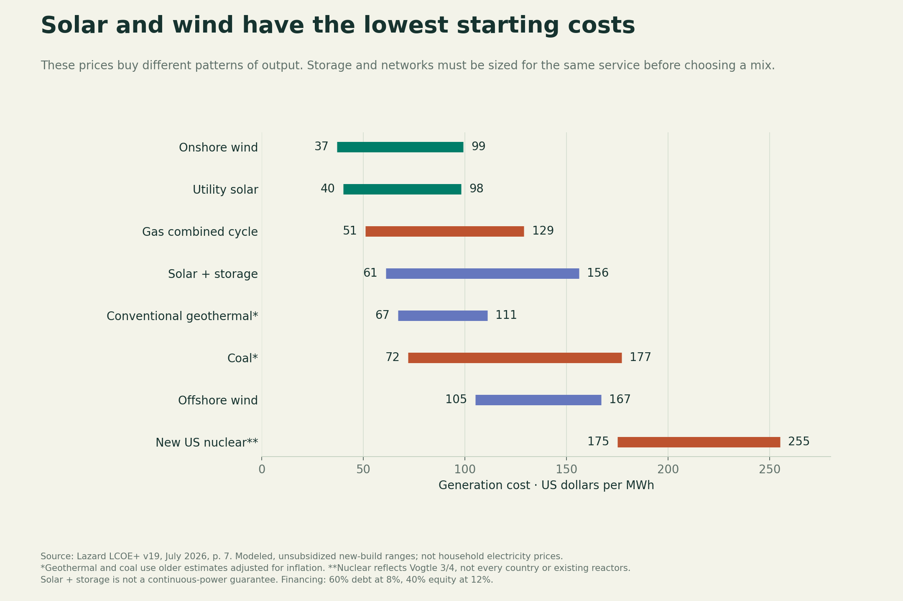
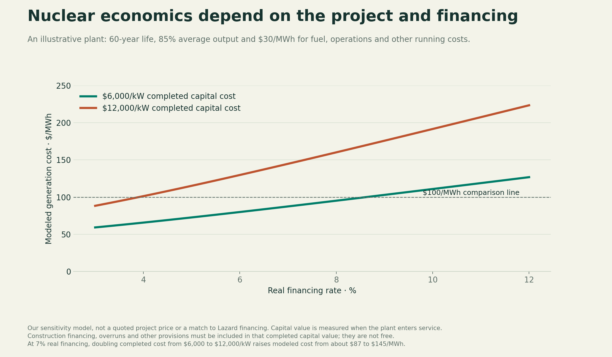
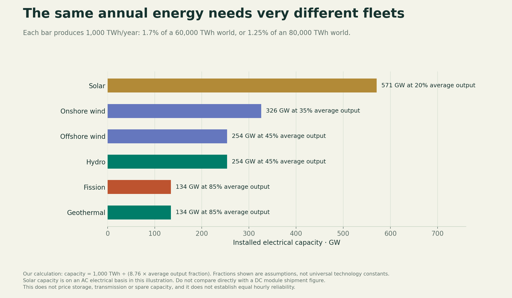
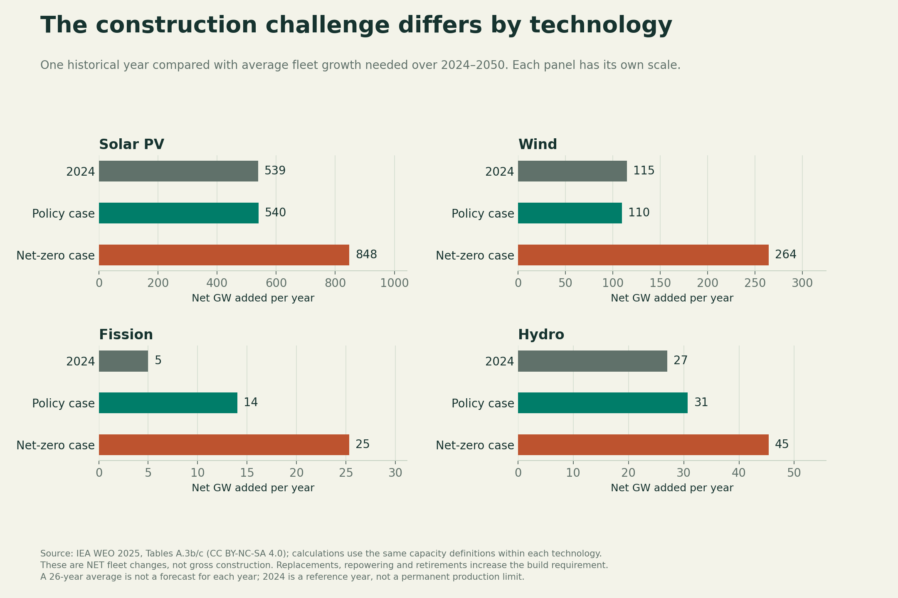
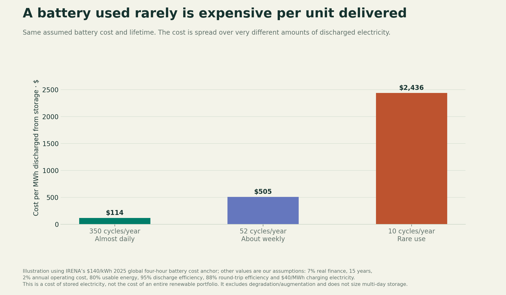

# Which technologies can meet the demand, at what cost, and by when?

Research answer · 24 October 2026 · Earth electricity first

Scope update: this is the cost and technology portion of the landscape. Read it with [company/funding/geopolitical records](LANDSCAPE.md) and [the supplied-evidence review](EVIDENCE_REVIEW.md). The user wants to map this landscape first, then propose an ambitious ocean-focused mix; no final portfolio has been chosen.

## Our answer

**Build solar and wind for most of the additional electricity; preserve and expand dependable low-emissions generation where the projects work; build the grids and storage that connect the two. Give emerging technologies a route to earn a larger role through operating evidence.**

The evidence supports these concrete positions:

1. **Solar and wind should do most of the expansion.** They combine comparatively low generation costs with manufacturing and construction already operating at large scale. Published 2050 cases put them at about **31,400–58,800 TWh/year combined**, or **54–73% of their respective generation totals**. These are scenario outcomes, not guaranteed supply or physical limits.
2. **Keep economical existing fission and hydro.** Evaluate new fission by actual project cost, financing and delivery record. Hydro, fission and geothermal supply valuable output when weather-dependent sources cannot; each still has outages or resource limits.
3. **Treat enhanced geothermal as a serious emerging contender.** Recent operating progress strengthens its case. Its largest potential contribution requires much lower costs and a huge increase in drilling and project delivery.
4. **Do not require fusion or wave power to satisfy the core demand plan.** Continue demonstrations and evaluate early markets. Assign extra output only in explicit success cases until net delivered electricity, lifetime, maintenance and repeatable cost are established.
5. **Price a complete service.** A low price for electricity when sunlight is available does not purchase electricity at every hour. A high average output from a reactor does not remove the need for reserve capacity or networks.

This recommendation prioritizes affordable, reliable and low-emissions supply. A numerical emissions limit and reliability standard still need to be specified for the later mix model. The work below is a technology comparison, not a claim that we have optimized a global portfolio.

## 1. What does electricity from each technology cost?

“Generation cost” below means the average revenue per unit of electricity needed to recover a plant's modeled lifetime costs. It is often called levelized cost of electricity. **It is not a household tariff, a market price at a particular hour, or the complete cost of a reliable grid.** $100/MWh equals 10 cents/kWh.

The first comparison uses one common source and financing framework:

| New generation | Unsubsidized cost, US$/MWh | What the number actually tells us |
|---|---:|---|
| Onshore wind | 37–99 | Low-cost generation at suitable sites; output varies |
| Utility solar | 40–98 | Low-cost daytime generation; output varies |
| Gas combined cycle | 51–129 | Depends strongly on fuel price and utilization; emissions remain |
| Solar plus storage | 61–156 | A particular hybrid configuration, not guaranteed continuous supply |
| Conventional geothermal | 67–111 | Older estimates adjusted for inflation; not a measured global price for new drilling methods |
| Coal | 72–177 | Older estimates adjusted for inflation; substantial emissions |
| Offshore wind | 105–167 | Higher construction and marine costs; output and access are site-specific |
| New US large nuclear | 175–255 | Based on Vogtle 3/4; not a worldwide nuclear price |

[Lazard LCOE+ v19, July 2026, p. 7](https://www.lazard.com/media/kcfconhf/lazards-lcoeplus_vf.pdf). Financing assumes 60% debt at 8% interest and 40% equity at 12%. Gas uses a $3.45/MMBtu fuel assumption. Project location, finance, fuel and operating pattern can change the ranking. The geothermal and coal estimates have a weaker current-project basis than the headline table may suggest.

An independent view of renewable projects commissioned worldwide in 2025 gives these weighted-average cost estimates:

| Technology | 2025 US$/MWh | Installed 2025 US$/kW |
|---|---:|---:|
| Onshore wind | 33 | 976 |
| Solar PV | 44 | 667 |
| Hydro | 62 | 2,079 |
| Offshore wind | 78 | 2,931 |
| Bioenergy | 86 | 3,606 |
| Conventional geothermal | 89 | 5,997 |
| Concentrated solar power | 115 | 2,418 |

These are IRENA estimates for a different population of projects, with different locations and financing. **Do not substitute the cheapest global average into an expensive local project.** In the same dataset, solar averages $35/MWh in India and $65/MWh in Germany; onshore wind averages $27 in China and $52 in Germany. [IRENA Renewable Power Generation Costs in 2025, pp. 13–16](https://www.irena.org/Publications/2026/Jul/Renewable-Power-Generation-Costs-in-2025), [public report mirror](https://tethys-engineering.pnnl.gov/sites/default/files/publications/Dardour-Zamora-2026.pdf).

### Existing and new nuclear must be evaluated separately

Lazard illustrates approximately **$31/MWh** as the midpoint operating cost of fully depreciated existing nuclear, **$71/MWh** for selected US restart projects, and **$214/MWh** for selected proposed small-reactor projects. These have different cost boundaries and evidence levels. The $31 figure is not a complete lifetime-extension bid; the $214 figure is not an operating SMR fleet average.

The IEA's repeat-build nuclear assumptions are much lower than Vogtle-based costs: its 2024 modeling inputs are approximately **$70/MWh in China, $75 in India, $110 in the US and $165 in the EU**. These assume established, repeated construction and differ from an audit of completed projects. The disagreement is evidence that **country, execution and financing matter**, not a reason to choose whichever number supports our preferred answer. [WEO 2025, pp. 453–455](https://iea.blob.core.windows.net/assets/5306bae2-1f99-402f-8d14-542bfa0ae96e/WorldEnergyOutlook2025.pdf).

Our explicit sensitivity experiment assumes a 60-year plant, 85% average output and $30/MWh of running costs. At 7% real financing, a completed capital value of $6,000/kW gives approximately **$87/MWh**; $12,000/kW gives approximately **$145/MWh**. Construction interest, overruns and provisions must be included in that completed value. These are assumptions, not project quotes.

## 2. How much electricity could each supply?

Use the same IEA scenarios as Question 1 so the production totals and demand story remain compatible. These figures represent **total output in 2050, including retained existing production**, not just output added between now and then. Percentage shares use each column's own total.

| Technology | 2024 output, TWh | 2050 stated policies: TWh / share | 2050 net zero: TWh / share |
|---|---:|---:|---:|
| Solar PV | 2,073 | 20,374 / 35.1% | 35,509 / 44.3% |
| Wind, onshore and offshore | 2,533 | 10,991 / 18.9% | 23,250 / 29.0% |
| Hydro | 4,448 | 6,383 / 11.0% | 7,398 / 9.2% |
| Fission, including SMRs | 2,835 | 5,531 / 9.5% | 6,853 / 8.5% |
| Bioenergy | 760 | 1,575 / 2.7% | 2,917 / 3.6% |
| Concentrated solar | 20 | 245 / 0.4% | 1,209 / 1.5% |
| Geothermal, all forms | 100 | 452 / 0.8% | 825 / 1.0% |
| Marine energy | 1 | 86 / 0.15% | 112 / 0.14% |
| Fossil generation without capture | 18,338 | 12,213 / 21.0% | 205 / 0.3% |
| Fossil generation with capture | 1 | 53 / 0.09% | 986 / 1.2% |
| Hydrogen/ammonia generation | 0 | 86 / 0.15% | 839 / 1.0% |
| **Total, including other output and rounding** | **31,229** | **58,081** | **80,175** |

[IEA WEO 2025, Tables A.3b–c](https://iea.blob.core.windows.net/assets/5306bae2-1f99-402f-8d14-542bfa0ae96e/WorldEnergyOutlook2025.pdf). Annex A: CC BY-NC-SA 4.0. The CSV includes a residual to reconcile the transcribed rows to the published totals. Bioenergy includes its captured-carbon subset; SMRs and advanced geothermal are not extra rows to add on top of their parent technologies. Hydrogen made with electricity is an energy carrier, not a new primary energy source.

**Our interpretation:** solar, wind, hydro and fission can collectively provide the bulk of the required electricity using established technology families. Expanding their fleets and making the combined system reliable remains a major engineering and investment task. Published scenarios support credible scale; they do not prove delivery of any individual proposed portfolio.

The construction task also includes replacing fossil generation. In the net-zero case, solar and wind add about **54,153 TWh/year** relative to 2024, which exceeds the **48,946 TWh/year** increase in all generation. That is possible because other sources decline. Meeting demand growth alone would not complete this transition.

## 3. How viable are the technologies in practice?

| Technology | What is established | What limits expansion | Our position |
|---|---|---|---|
| **Solar PV** | Mass production and deployment; low-cost generation in many markets | Grids, siting, midday surplus, night and seasonal output, finance | Expand rapidly where output can be connected and used; include storage and complementary supply |
| **Onshore wind** | Large operating industry and low-cost sites | Permitting, local acceptance, transmission, variable weather | A main growth technology; test its hourly complementarity with solar |
| **Offshore wind** | Commercial fixed-bottom fleets | Marine installation/repair, cables, ports, financing; floating projects have less mature economics | Build selectively in strong resources near valuable coastal demand; do not apply fixed-bottom costs to all floating wind |
| **Hydro** | Large operating fleet; reservoirs can store energy and vary output | Suitable sites, ecosystem/social impacts, drought and competing water uses | Preserve and upgrade worthwhile plants; add projects only after site and water assessment |
| **Large fission** | Decades of commercial electricity and high availability | Cost and schedule risk, skills, fuel supply, licensing, cooling and waste management | Retain economical safe plants; expand through credible repeat-construction programs |
| **SMRs/advanced fission** | Some designs operate in China/Russia; several new designs are in construction/development | First projects must prove cost and schedule; some designs need special fuel; factory scale is not yet established | Evaluate actual designs and contracts; smaller does not automatically mean cheaper |
| **Conventional geothermal** | Commercial power at suitable reservoirs | Accessible geology, drilling, reservoir decline and site conditions | Expand where the resource and delivered economics are established |
| **Enhanced/closed-loop geothermal** | Early operating progress; drilling methods are advancing | Well cost, flow and temperature, pumping, reservoir life, water/seismic management; designs differ | A priority emerging option; validate each approach independently |
| **Bioenergy** | Commercial plants and dispatchable output | Sustainable feedstocks, competing land/material uses, air pollution, full carbon accounting | Use limited, defensible resources; avoid treating all biomass as carbon neutral |
| **Concentrated solar with heat storage** | Operating commercial plants | Direct sunlight, site/water needs, construction costs; limited deployment | A location-specific competitor to PV plus storage and other dependable sources |
| **Wave/tidal stream** | Demonstrators and small arrays; tides are predictable | Small fleet, marine damage and repair costs, grid connection and financing | Demonstrate and target suitable local markets; no required bulk global share yet |
| **Fusion** | Significant physics and engineering progress | Sustained net electricity, materials life, maintenance, fuel cycle where relevant, complete plant cost and manufacturing | Fund development; keep baseline demand covered without assuming commercial success |
| **Gas/coal** | Mature, controllable generation | Fuel exposure, air pollution and greenhouse emissions; new turbine delivery constraints | Include as honest benchmarks; constrain use according to the emissions and reliability requirements |
| **Fossil plants with capture** | Capture components and limited integrated experience | Complete capture-chain cost, energy penalty, CO2 transport/storage, residual and upstream emissions | Test project-specific cases; capture percentage is not a whole-system emissions guarantee |

The IEA reports renewable projects commonly taking **1–5 years**, while new grid infrastructure can take **5–15 years**, including planning and permitting. Those broad ranges do not promise a particular project's connection date. [IEA Electricity 2026: Grids](https://www.iea.org/reports/electricity-2026/grids).

### Recent evidence that changes the emerging-technology assessment

**Enhanced geothermal:** Fervo announced on 1 October 2026 that the first Cape Station GeoBlock had reached commercial operation and produced **33 MW net**. The remaining two units in the approximately 100 MW first phase were still commissioning, with a January 2027 target; an additional 400 MW is targeted for 2028. Count 33 MW as the company's operating claim, not the entire future 500 MW development. Early commercial output is stronger evidence than a drawing or purchase agreement, but it does not establish decades of reservoir performance. [Fervo announcement](https://fervoenergy.com/fervo-energy-declares-commercial-operation-at-cape-station-ahead-of-schedule-leading-the-race-for-next-generation-geothermal-energy/).

**SMRs:** Darlington provides a concrete project to track. OPG reports a first-unit budget of **C$7.7 billion**, including infrastructure shared with later units, interest, escalation and contingency. The design is a 300 MW reactor. Dividing that budget by capacity gives **C$25,700/kW**, but this is neither an overnight equipment price nor the cost of a future repeated unit. It demonstrates why complete project boundaries matter. [OPG 2025 financial report](https://www.opg.com/wp-content/uploads/2026/03/2025-Q4-OPG-PR-MDA-FS-FINAL.pdf), [CNSC project status](https://www.cnsc-ccsn.gc.ca/eng/reactors/new-reactor-power-plant-projects/new-reactor-power-plant-facilities/darlington-new-nuclear-project/).

**Fusion:** CFS targets a roughly **400 MW** ARC plant in the early 2030s. Helion targets at least **50 MW** and initial operations in 2028. These are company targets, not demonstrated commercial generation. DOE's June 2026 roadmap still identifies gaps needed for pilot plants and commercialization. We did not establish a verified commercial fusion electricity cost. [CFS](https://www.cfs.energy/technology/arc/), [Helion](https://www.helionenergy.com/orion), [DOE roadmap](https://www.energy.gov/articles/energy-department-releases-finalized-fusion-science-and-technology-roadmap-accelerate).

## 4. What does a meaningful share of demand require building?

For an equal **1,000 TWh/year** of plant output, the assumed average output fractions below imply:

| Technology | Assumed average output / rated power | Required electrical capacity |
|---|---:|---:|
| Solar | 20% | 571 GW |
| Onshore wind | 35% | 326 GW |
| Offshore wind | 45% | 254 GW |
| Hydro | 45% | 254 GW |
| Fission | 85% | 134 GW |
| Geothermal | 85% | 134 GW |

Calculation: `GW = TWh / (8.76 × average output fraction)`. These assumptions are illustrative. Location, downtime and operation change them. They compare annual output, not equal availability at every hour. Solar uses an AC electrical basis here; module-shipment figures commonly use a different DC basis.

Using WEO's own consistent capacity series, the two 2050 pathways require the following average **net** fleet increases over 2024–2050:

| Technology | Policy case, GW/year | Net-zero case, GW/year | 2024 net increase in the same source |
|---|---:|---:|---:|
| Solar PV | 540 | 848 | 539 GW |
| Wind | 110 | 264 | 115 GW |
| Fission | 14 | 25 | 5 GW |
| Hydro | 31 | 45 | 27 GW |

The industry must also replace retired assets, so gross construction is higher. A 26-year average hides the ramp-up and replacement schedule. These are not factory-capacity forecasts. The newer IEA review reports just **3 GW of nuclear additions and 3 GW of retirements in 2025**, with approximately **78 GW under construction** as of its assessment. This makes accelerated delivery and lifetime extensions central to a larger nuclear role. [WEO Annex A](https://iea.blob.core.windows.net/assets/5306bae2-1f99-402f-8d14-542bfa0ae96e/WorldEnergyOutlook2025.pdf), [IEA Global Energy Review 2026: Nuclear](https://www.iea.org/reports/global-energy-review-2026/technology-nuclear).

### How much could emerging options add?

| Option | Concrete scale comparison | How to use it |
|---|---|---|
| SMRs | IEA cases of 40, 120 and 190 GW in 2050 would yield about **298, 894 and 1,415 TWh/year** at our assumed 85% average output | About **0.4–2.4%** of a 60,000–80,000 TWh world across these cases; already part of fission |
| Next-generation geothermal | IEA's conditional low-cost potential reaches nearly **6,000 TWh/year**, or **7.5–10%** of our two targets | Much more ambitious than WEO's 452–825 TWh total geothermal output; requires technology improvements and lower costs, not a guaranteed increment |
| Marine | WEO's **86–112 TWh/year** in the two 2050 cases remains about **0.14–0.15%** of each case | Could matter locally; scenario scale does not establish a hard resource limit |
| Fusion | To reach even **1% of 80,000 TWh**, fusion would need **107 GW** at an assumed 85% average output | Equivalent to about **269 plants of 400 MW**. A first plant is the start of the scaling task, not its completion |

[IEA nuclear scenarios](https://www.iea.org/reports/the-path-to-a-new-era-for-nuclear-energy/executive-summary), [IEA geothermal potential study](https://www.iea.org/reports/the-future-of-geothermal-energy/executive-summary). The geothermal study's approximately $50/MWh in 2035 is a **conditional low-cost outcome**, not today's established price. Its “15%” headline means a share of demand **growth**, not 15% of all electricity. Fusion's 1% example is our arithmetic, not a forecast.

## 5. What about wave power, carbon capture and storage costs?

**Wave and tidal:** IRENA's emerging-technology review gives approximate current estimates of **$454/MWh for wave** and **$358/MWh for tidal stream**, with European learning projections near **$120 and $140/MWh**, respectively, at 2 GW of cumulative deployment. These use developer surveys and models, not the mature-project evidence behind the renewable averages. The ocean resource alone does not establish economic viability. For offshore computing or fuel production, compare the complete customer product rather than electricity alone. [IRENA, pp. 153–156](https://tethys-engineering.pnnl.gov/sites/default/files/publications/Dardour-Zamora-2026.pdf).

**Gas with capture:** NETL's matched US engineering cases estimate **$41.9–47.0/MWh without capture**, versus **$77.8–84.3/MWh with 95% stack CO2 capture**, including CO2 transport and storage. These are **2023-dollar modeled costs**, with 85% utilization and $3.42/MMBtu gas, not 2026 market quotes. The capture cases cost about **79–86% more** within that study. Low-utilization backup operation would spread capital cost over less output. Upstream methane and residual emissions still matter. Do not merge this range with Lazard's differently dated and financed range. [NETL, May 2025, Exhibit ES-6](https://netl.doe.gov/projects/files/CostandPerformanceBaselineFossilEnergyPlantsVolume1BituminousCoalNaturalGastoElectricity_052125.pdf).

**Storage:** batteries and pumped hydro move electricity in time and consume some energy doing so. They must not be credited as independent primary generation. IRENA's 2025 global four-hour battery cost anchor is approximately **$140/kWh installed**. How often a storage asset is used has a large effect on its cost per discharged unit.

Our explicitly assumed battery model gives about **$114/MWh discharged at 350 cycles/year**, **$505 at 52 cycles**, and **$2,436 at 10 cycles**, including assumed charging electricity. It uses 7% real financing, a 15-year life, annual operating cost of 2% of installed cost, 80% usable energy, 95% discharge efficiency, 88% round-trip efficiency and $40/MWh charging electricity. Degradation and augmentation are not modeled. These are not market offers or a complete cost of solar electricity.

**Implication:** batteries can be valuable for frequent short shifts. Rare long shortfalls may favor other storage types, dependable generation, wider transmission or flexible demand. Low cycle frequency can still be justified by reliability value or other services; this graph does not price those benefits. Pumped hydro, compressed air, flow batteries, thermal storage and hydrogen must each be tested at the required duration and site. Heat storage is particularly relevant where the customer needs heat rather than electricity.

## 6. Our concrete decision for the next model

**Primary expansion candidates:** solar PV and onshore wind, with offshore wind where its local output justifies its higher cost. Model them together with networks, short-duration storage and feasible demand shifting.

**Dependable supply candidates:** existing fission and hydro, economical life extensions and upgrades, credible repeat-build nuclear projects, and site-proven geothermal. Compare their contribution to difficult hours, including outages, drought and regional constraints.

**Emerging development priorities:** enhanced geothermal and selected SMR projects deserve close project-level monitoring. Fusion, wave/tidal, floating wind, new solar cells and long-duration storage deserve evidence-based development cases. Do not assign a cost improvement or completion date simply because a developer targets it.

**A correction to our earlier draft mix:** the previously assumed 15% fission share in an 80,000 TWh world means **12,000 TWh/year**, about **1,612 GW at 85% average output**. From the WEO 2024 fleet, that requires nearly **46 GW of net growth per year**, before retirements. The prior 2% geothermal share means **1,600 TWh**, almost twice the WEO net-zero geothermal figure. Both remain useful ambitious cases, but neither is an established baseline. Use the published cases as reference portfolios and let region-specific costs, hourly reliability and build constraints determine whether increasing those shares improves the system.

What would change our recommendation?

- Repeated nuclear projects finishing at lower completed costs and credible schedules would support a larger fission share.
- Geothermal wells showing sustained output, low pumping needs and repeatable low cost across several sites would support much more geothermal.
- More expensive networks, persistent renewable shortages or severe siting limits would increase the value of local dependable generation.
- Reliable low-cost long-duration storage would support higher wind/solar shares.
- Fusion delivering independently verified net electricity with an operating cost and maintainable plant would move it from development to procurement analysis.
- Wave/tidal systems showing sustained net output, survivability and manageable repair costs could earn valuable local roles and wider deployment.

**We have enough evidence to choose the technologies to model seriously. We do not yet have evidence for one globally optimal percentage mix or a single complete system price.** The next model must compare equal hourly service, emissions, weather years, financing and construction constraints.

## Methods and reproducibility

- `technology_analysis.py` reproduces six PNG/SVG figures and ten CSV files; `technology_results.json` includes inputs, source links and limitations.
- Published cost ranges, commissioned-project averages, company statements, conditional scenarios and our assumptions are identified separately. Missing commercial fusion prices remain missing.
- All scenarios retain WEO 2025's common 2024 baseline. Newer evidence is reported separately rather than spliced into older series.
- Arithmetic checks reconcile generation totals, capacity/output conversions, net construction and storage-cost ordering. They do not validate a forecast or reliability model.
- Figures were inspected for legibility. WEO Annex A carries CC BY-NC-SA 4.0; retain attribution and check all source terms before publishing the website.
- This chapter covers electricity supply on Earth. Direct fuels/heat and complete orbital/lunar/Martian systems require their own matched-service comparisons later.
