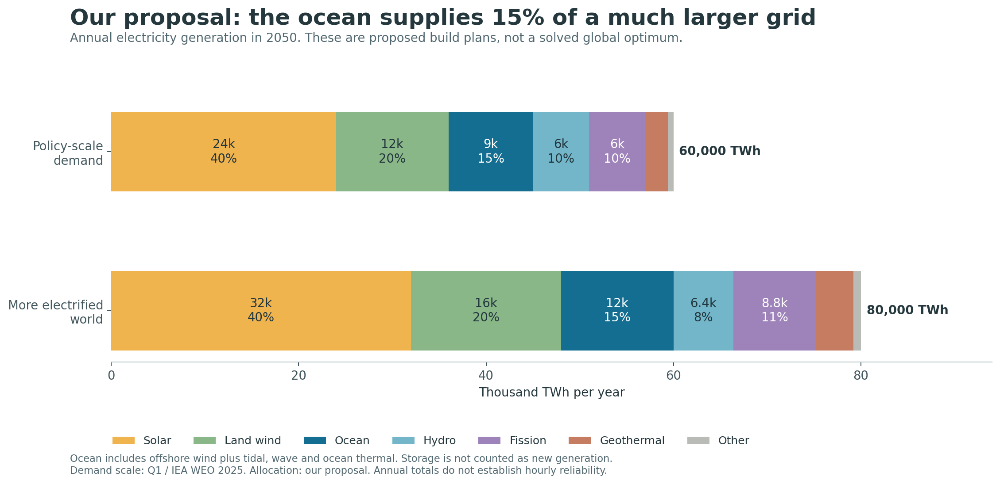
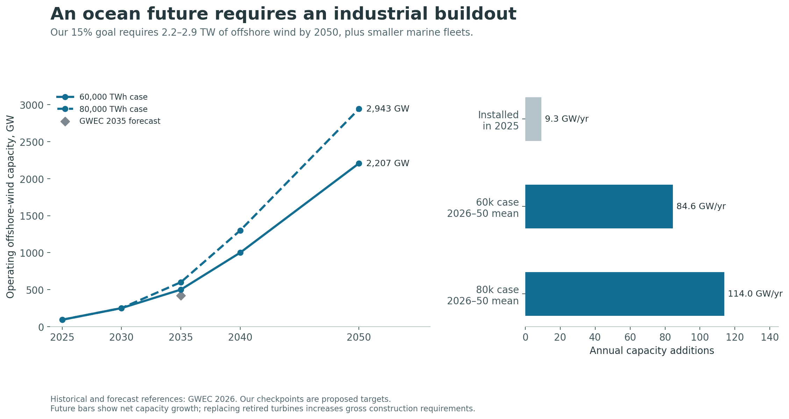
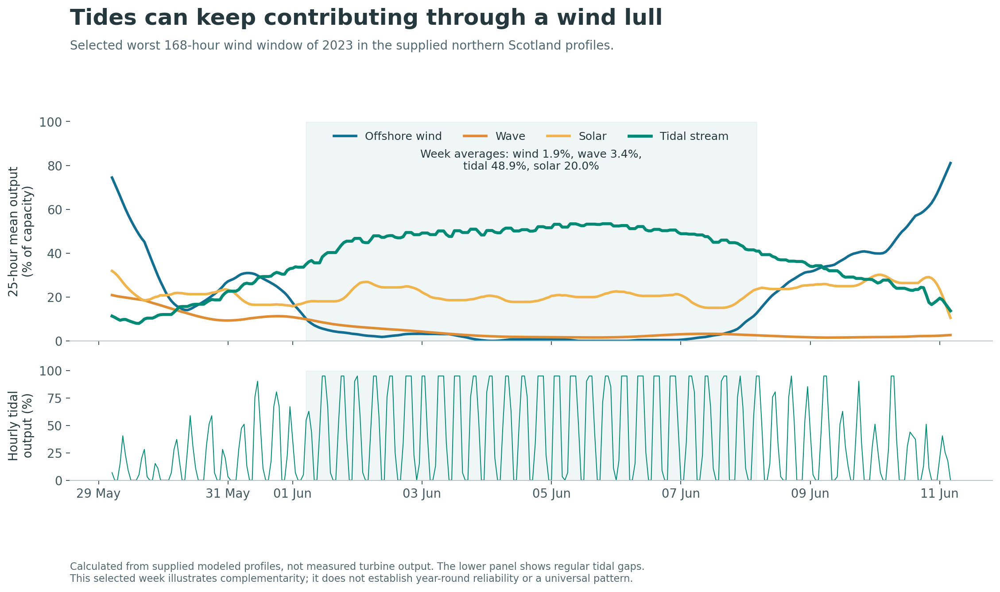

# Q3 — Build an ocean-powered coast inside a clean global grid

**Our proposal: make ocean-based generation a major part of the future electricity system—15% globally by 2050, and a much larger share in suitable coastal regions. Build offshore wind at industrial scale, commercialize tidal stream, and combine them with solar, storage, transmission and clean power that can run through long shortages.**

Solar supplies the largest global share. The ocean becomes a major place to build and a source of useful diversity. Fission and geothermal help keep the system dependable. Fusion can join when it proves itself; the plan can proceed without it.

This is an optimistic **build proposal**, dated 24 October 2026. The annual quantities below are our choices to test against Q1's demand cases. They are not the output of a worldwide cost optimization. Our separate hourly experiment tests the narrower question of when tides improve a coastal supply system. That distinction lets us make a specific recommendation without claiming more than the research establishes.

## 1. The complete mix we propose

Q1 established two useful 2050 electricity-generation cases: **60,000 TWh/year** and **80,000 TWh/year**. They roughly bracket the policy-led and more electrified pathways we studied. One TWh is one billion kWh. These are generation totals, not final electricity consumed by customers. [Q1 answer](../question1/ANSWER.md); [IEA WEO 2025](https://iea.blob.core.windows.net/assets/5306bae2-1f99-402f-8d14-542bfa0ae96e/WorldEnergyOutlook2025.pdf).

| Source | 60,000 TWh case | Share | 80,000 TWh case | Share | Its job |
|---|---:|---:|---:|---:|---|
| Solar | 24,000 TWh | 40% | 32,000 TWh | 40% | Large volumes of inexpensive daytime electricity |
| Land-based wind | 12,000 | 20% | 16,000 | 20% | Low-cost electricity with a different production pattern from solar |
| **Ocean-based generation** | **9,000** | **15%** | **12,000** | **15%** | Supply coastal demand at scale and add tidal diversity |
| Hydropower | 6,000 | 10% | 6,400 | 8% | Existing clean generation and flexibility where reservoirs permit |
| Fission | 6,000 | 10% | 8,800 | 11% | Dependable clean generation, especially where construction is competitive |
| Geothermal | 2,400 | 4% | 4,000 | 5% | Expand a source of electricity and heat that does not depend on weather |
| Other clean generation | 600 | 1% | 800 | 1% | Regional options such as sustainable bioenergy and solar thermal |
| **Total** | **60,000** | **100%** | **80,000** | **100%** | |

**Storage, transmission and flexible consumption sit underneath this table.** Batteries return electricity generated elsewhere, with some losses; adding them as a generation percentage would count energy twice. Hydrogen made using electricity is also a use of electricity, not an extra primary source.

Why this allocation? We give three-quarters of production to scalable solar, land wind and ocean generation. We reserve a substantial role for hydro, fission and geothermal to reduce dependence on weather and very large stores of electricity. Hydropower grows more slowly in the upper case because suitable rivers and acceptable projects are limited; fission and geothermal take larger shares. **The exact 40/20/15 split is a transparent design choice, not a discovered optimum.** Regional costs and hourly testing should be allowed to change it.

The geothermal allocation is particularly optimistic. It requires commercialization well beyond today's sector. For scale, the IEA's conditional lower-cost case reaches almost 6,000 TWh and 800 GW in 2050; our 2,400–4,000 TWh stays below that conditional case but greatly exceeds its ordinary policy projection. [IEA geothermal assessment](https://www.iea.org/reports/the-future-of-geothermal-energy/executive-summary).

## 2. What “ocean energy” actually means in our proposal

**Offshore wind supplies the volume. Tidal stream is our lead investment in energy taken directly from moving seawater. Wave and ocean thermal earn larger roles as they demonstrate reliable, economical operation.**

Offshore wind is wind energy located at sea. We identify it separately from tidal, wave and ocean thermal power throughout the calculations. Calling all four “ocean-based” describes the proposed coastal infrastructure; it does not make their energy sources identical.

| Ocean component | 2050 annual output, lower / upper case | Required operating capacity | What we should do |
|---|---:|---:|---|
| **Offshore wind** | **8,700 / 11,600 TWh** | **2,207 / 2,943 GW** at 45% average output | Use fixed foundations where practical; expand floating systems where depth and economics justify them |
| **Tidal stream** | **150 / 200 TWh** | **49 / 65 GW** at 35% | Build repeatable arrays in strong tidal channels; prioritize its contribution during difficult grid hours |
| Wave | 100 / 133 TWh | 38 / 51 GW at 30% | Start with independently maintainable arrays; share ports or cables only where the economics support it |
| Ocean thermal, or OTEC | 50 / 67 TWh | 7 / 9 GW at 85% | Develop tropical applications with a suitable temperature difference and a real local customer |
| **Total ocean-based** | **9,000 / 12,000 TWh** | Technology-specific capacities above | **15% of either global case** |

Capacity is calculated as `annual TWh ÷ (8.76 × average-output fraction)`. The fractions are planning assumptions, not guarantees. They already describe average plant production; storage and delivery losses still need separate treatment.

Strict marine technologies supply **300–400 TWh, or 0.5% of global generation**, in this proposal. That is a major industrial expansion from today's demonstrations. It is not a claim that tides alone can power the planet. Their local value can be much greater than their global percentage, because electricity delivered during a shortage can avoid expensive backup or storage.

Our offshore target has external scale precedents: the Global Offshore Wind Alliance targets 2,000 GW by 2050, while a published IRENA climate scenario uses 2,465 GW. Our lower case is near those scales; our 2,943 GW upper case requires a further acceleration. Those precedents do not establish that our particular mix is cheapest. [IRENA/GOWA](https://www.irena.org/News/articles/2025/Sep/Offshore-Wind-From-83-GW-Today-to-2000-GW-by-2050), [IRENA offshore scenario](https://www.irena.org/Digital-content/Digital-Story/2024/Jul/The-Role-of-Offshore-Wind-in-the-Energy-Transition/detail).

## 3. How it meets the growth we forecast

From Q1's consistent 2024 baseline of 31,229 TWh, the rounded 60,000/80,000 TWh cases imply **2.54%/3.68% annual growth through 2050**. Those rounded-case rates differ slightly from the exact published-scenario rates in Q1. They require the world to add roughly **1,107–1,876 TWh of annual production each year**, on average, before allowing for retired plants.

The proposed ocean sector contributes 9,000–12,000 TWh of the final system—equivalent to roughly **29–38% of the entire world's 2024 electricity generation**. The rest of the portfolio contributes 51,000–68,000 TWh. **Ocean generation makes a large contribution to the expansion; it does not have to cover the entire increase by itself.**

| Technology | Operating capacity needed in 2050, lower / upper case | Output assumption |
|---|---:|---|
| Solar | 13.7 / 18.3 TW | 20%, AC plant basis |
| Land wind | 3.9 / 5.2 TW | 35% |
| Offshore wind | 2.2 / 2.9 TW | 45% |
| Hydro | 1.52 / 1.62 TW | 45% |
| Fission | 0.81 / 1.18 TW | 85% |
| Geothermal | 0.32 / 0.54 TW | 85% |

These are total operating fleets, not additions to today's fleets. Output lost to retirement, degradation or damaged equipment has to be replaced. No universal capacity assumption is imposed on the “other” category.

For offshore wind, the construction task is especially concrete. Starting from **92.5 GW at the end of 2025**, reaching our target requires average **net additions of 85–114 GW/year** through 2050—about **9–12 times the 9.3 GW installed in 2025**. With illustrative 15 MW turbines, that is roughly **5,600–7,600 additional turbines each year on average**, plus replacements. Turbine ratings will vary; this is a manufacturing-scale translation, not a supplier forecast. [GWEC 2026](https://www.gwec.net/news/gwec-report-fast-track-offshore-wind-to-help-prevent-future-energy-crises).

Our proposed checkpoints are 250 GW offshore wind in 2030, **500–600 GW in 2035**, 1,000–1,300 GW in 2040, and 2,207–2,943 GW in 2050. The 2035 target exceeds GWEC's 420 GW forecast by about 19–43%. This is a proposal to change the trajectory, not a forecast that it happens automatically. It requires coordinated orders for turbines, foundations, cables, vessels, substations and ports.

**Annual energy is only the first test.** Q1's totals include the operating needs and losses of the published scenarios. Our system has different losses and unused generation. A final design must work backward from regional customer demand, include electricity used to make fuels, and calculate its own required generation. We have balanced the annual generation portfolio and tested a coastal hourly example; we have not yet proved that this global portfolio serves every regional hour.

## 4. Why combining ocean technologies can improve the system

The most compelling argument for tidal stream is **timing**. Wind follows weather. Tidal currents largely follow an astronomical schedule. A system can benefit from having both, even if tidal electricity costs more at the plant.

In the supplied northern Scotland profiles, the worst rolling wind week of 2023 ran from 1 June at 05:00 to 8 June at 04:00. Offshore wind averaged **1.9%** of capacity, wave **3.4%**, and tidal stream **48.9%**. Solar averaged 20.0% in that summer window. Across the three supplied years, hourly wind–tidal correlation was about **0.01**, versus **0.41** for wind–wave. These are calculations from modeled profiles, not measured farm output.

Tides still stop or weaken regularly. Predictable output is not constant output. Batteries can help bridge shorter gaps, while weak tidal periods and wider weather shortages may require longer storage, imports, reservoir hydro, fission or geothermal. We should buy the least expensive credible combination rather than require one storage technology everywhere.

There is independent support for the system mechanism. A 2026 Great Britain modeling study found that substituting up to 5 GW of tidal for offshore wind reduced gas generation in its selected low-wind case. Its reported dispatch-cost benefit does **not** include all comparative construction costs, so it supports the timing argument rather than proving universal total-cost savings. [Coles and Adcock, 2026](https://marineenergyjournal.org/imej/article/view/318).

The research decision is therefore: **pay for valuable delivery, not just inexpensive annual MWh.** A tidal project should win more investment when a regional model shows that its timing saves more elsewhere in the system than its extra cost.

## 5. What the hourly cost experiment establishes

The checked experiment and its numerical results are in [HOURLY_RESULTS.md](HOURLY_RESULTS.md). It uses the supplied profiles and enforces service to every modeled hour. We distinguish the supplied cost coefficients from a consistent $74/MWh floating-wind assumption and compare tides at several explicitly hypothetical future prices.

**A concrete early result:** at an assumed future tidal generation cost of **$90/MWh**, the checked three-year model chooses **55.4% tidal generation** and lowers total supply cost from **$220.00 to $180.03/MWh**, an **18.2% reduction** against the otherwise identical no-tidal case. It serves all 26,304 modeled hours. The selected system still uses land wind, solar, batteries and about **162 GWh of longer-duration storage** per 1 GW of constant load. This is a strong conditional case for a large local tidal role; it depends on achieving the assumed costs and performance.

The experiment is an isolated **1 GW constant load**, not Scotland's actual grid. It has no regional transmission, imports, demand flexibility, operating reserves, explicit equipment failures or site limits. Nuclear uses a simplified availability assumption. Those omissions can change the winning mix and mean that the result is not a delivered commercial price.

**Let dependable clean power compete.** When the supplied nuclear option is allowed, the same simplified model chooses an entirely nuclear supply at **$166.81/MWh**; an assumed $100/MWh firm option wins at **$100/MWh**. Both rely on nuclear output being available at 90% of installed capacity in every hour, with no modeled outages or build limits. Those are strong assumptions, so the result is a sensitivity rather than a real-world nuclear procurement conclusion. It also means our checked experiment does **not** establish an ocean-only or universally ocean-dominant optimum.

Our original model review is documented in [MODEL_AUDIT.md](MODEL_AUDIT.md). The important point for the proposal is that **ocean-first should welcome complementary clean generation**. A cheap, dependable geothermal or nuclear option may reduce the need for very large stores of electricity. An expensive or delayed option may leave more work for ocean generation, interconnection and storage. That is a reason to build a portfolio.

## 6. What we should build first

**Start with a grid-connected coastal industrial hub in northern Scotland or the adjoining North Sea region, then adapt the design to other coasts.** The strong resource and existing marine experience make it a useful first research and procurement case. A specific location still needs measured currents, seabed surveys, grid studies and local agreement.

Our reference project for the first development round is:

- **1 GW of offshore wind**, using the most economical suitable foundation type.
- **20 MW of tidal stream initially**, with a route to 100 MW after operating and environmental results justify expansion.
- **200 MW / 800 MWh of batteries** as an initial specification for hourly balancing; confirm the rating against the actual grid and customer loads.
- **Up to 100 MW of flexible industrial demand**, such as water pumping, electric boilers feeding heat stores, or selected fuel-production processes with product storage. Customers must specify how much timing flexibility they can genuinely offer.
- **A grid connection and contracted dependable supply** for prolonged shortages, priced alongside longer-duration storage.
- **A separate 5–10 MW wave trial** where wave conditions and maintenance access justify it. A shared port or cable is useful only if it lowers the combined cost; a shared floating platform is a separate engineering decision.

At 45% wind and 35% tidal average output, the initial 1 GW + 20 MW combination produces about **4.00 TWh/year before balancing and delivery losses**. Expanding tidal to 100 MW takes that to **4.25 TWh/year**. This is roughly 457–485 MW averaged over a year. **It is not a promise to serve a 1 GW customer continuously.** The grid, contracts and customer's hourly needs determine the service we can sell.

This hub specification is a proposed demonstration and commercial-development brief, not an optimized or construction-ready plant. Its purpose is to build the missing evidence: several years of useful output, repair costs, environmental monitoring, actual contract prices and demonstrable savings from combining technologies.

Relevant suppliers and operating experience already mapped in Q2 include **Vestas and established offshore developers** for wind; **Orbital, MeyGen/Ampeak and Minesto** for different tidal approaches; **CorPower** for wave; and **Global OTEC** for a separate tropical development route. **Form Energy, Hydrostor and other qualified storage suppliers** should compete against batteries, grid imports and clean firm generation on the same service requirement. Listing them is not an endorsement of unverified performance or an exclusive procurement decision. [Q2 company evaluations](../question2/LANDSCAPE.md).

## 7. A build program with decisions at each stage

| Period | What we propose | Evidence needed to expand |
|---|---|---|
| 2026–2030 | Bring the first hubs through design and construction; aim for 250 GW global offshore wind and a 300–500 MW global tidal learning fleet | Contracted connections, several maintainable arrays, published output and repair costs, accepted environmental monitoring |
| 2030–2035 | Reach 500–600 GW offshore wind and about 3 GW tidal; develop larger wave arrays and 5–10 MW-class OTEC demonstrations | Repeatable construction and regional total-cost benefits; financeable performance guarantees |
| 2035–2040 | Expand successful designs, ports and transmission; approach 1,000–1,300 GW offshore wind | Regional supply plans pass several weather years and credible outage tests; supply chains support the orders |
| 2040–2050 | Reach the proposed 15% ocean contribution; expand tidal toward 49–65 GW and successful wave/OTEC fleets | Projects keep improving delivered cost and reliability; cumulative ecological effects stay acceptable |

The early tidal fleet buys information and industrial learning as well as electricity. **3 GW at 35% average output produces only about 9.2 TWh/year**. Its strategic purpose is to establish a technology that can subsequently scale; it is not a large immediate answer to global demand growth.

ORE Catapult's published pathway associates a 2035 tidal cost of **£78 ±25/MWh in 2012 pounds** with **2.6 GW worldwide**, not 1 GW. It is conditional on deployment, innovation and financing. We use the 3 GW milestone as a program to test that learning, not a guarantee that crossing it delivers a particular price. [ORE Catapult, 2022](https://cms.ore.catapult.org.uk/wp-content/uploads/2022/10/Tidal-stream-cost-reduction-report-T3.4.1-v1.0-for-ICOE.pdf).

Support should fund measurable progress: competitive long-term power contracts, early shared infrastructure, first-array engineering and environmental research, and publication of operating results. Replication should depend on delivered energy, reliability, maintenance cost and the value to the local grid. A project announcement or equipment order is not delivered power.

## 8. Where this is better—and where another combination wins

| Alternative | Our advantage | Decision rule |
|---|---|---|
| Solar-heavy supply alone | Ocean wind and tides add production at different times and can serve coastal areas with scarce land | Compare full hourly systems, including land wind, storage, grids and firm generation; solar remains our largest global source |
| Wind and solar without tides | Tidal timing can reduce exposure to the same weather shortage | Expand tidal only where total avoided system costs exceed its generation premium |
| Imported fossil generation | Wind, tides and waves need no recurring fuel delivery and support a lower-emissions system | Include construction, backup, lifecycle impacts and financing; “no fuel” does not mean “no supply-chain risk” |
| Fission-heavy supply | Ocean projects offer another construction route and let regions diversify technologies and suppliers | Build fission where it is competitive; do not force a more expensive ocean system to exclude it |
| Waiting for fusion | Offshore wind already operates at industrial scale and marine projects can build experience now | Require repeatable net-electric output and complete costs before allocating essential demand to fusion |
| Space solar sent to Earth | Coastal infrastructure can expand through existing ports, grids and manufacturing | Compare equivalent power delivered on Earth; orbit-based computing is a different service, and space-to-Earth solar remains a development concept |

**We are not claiming a free or uniformly cheap ocean.** Q2's latest common global cost dataset puts offshore wind at about $78/MWh, compared with $44 for solar and $33 for land wind, for the particular projects and source methods covered. These are generation costs; they do not purchase identical hourly service. Floating wind, tidal and wave are less mature and require their own cost evidence. Our case depends on location, useful delivery and improvements in construction—not on pretending the current price premium has disappeared. [Q2 costs](../question2/COST_AND_SCALE.md).

Fuel independence also changes rather than eliminates geopolitical exposure. Ports, turbines, electrical equipment, subsea cables, access rights and cross-border grid agreements matter. Use multiple qualified suppliers, build maintenance capacity locally, and protect cable routes. Include fishing communities and other sea users in siting. Evidence from small marine projects does not settle the environmental effects of large arrays. [PNNL/OES-Environmental](https://www.pnnl.gov/publications/new-report-provides-update-environmental-effects-marine-renewable-energy).

## 9. Make the plan resilient to technology disappointments

If wave and OTEC remain expensive, keep developing valuable applications without making the global expansion depend on them. **Replacing the entire 300–400 TWh marine allocation with offshore wind requires about 76–101 GW extra wind at 45% output**, roughly 3.5% on top of the offshore fleets in our proposal. The annual ocean target can survive that change, although the lost tidal timing benefit would need another solution.

If cheap multi-day storage is delayed, allow more clean firm generation, transmission and feasible load shifting. Do not keep promising the same price for a system with worse inputs. If geothermal development disappoints, the replacement supply must be explicitly sized and costed: for example, 1,000 TWh/year is about 134 GW of fission at 85% average output, before integration differences.

If the offshore construction pace falls short, solar and land wind can cover some annual energy, but their local timing, land use and grid requirements must be recalculated. Conversely, successful fusion or much cheaper geothermal should compete for future contracts. Our objective is inexpensive, dependable clean energy; the ocean program should improve that outcome.

## 10. Our position for the final website

**“The future grid should reach into the ocean. Build offshore wind at scale, use tides where their timing adds value, and connect coastal energy hubs to a wider mix of solar, storage and dependable clean power.”**

The specific global proposal is **40% solar, 20% land wind, 15% ocean generation, and 25% hydro, fission, geothermal and other clean sources**. It is an optimistic strategy to build and test, with a defined 9,000–12,000 TWh ocean contribution. The most important local question is how much the combination reduces the cost of serving the customer reliably.

For the visual story, let readers change demand, tidal cost, storage cost and the availability of firm power. Show the required fleet and the resulting modeled coastal system. Keep the discarded-energy and unmet-demand indicators visible. The ambition becomes more convincing when the reader can see what has to be built and what changes the answer.

Earth's ocean proposal does not transfer to orbit, the Moon or Mars. Those locations lack the same operating environment and require their own solar/fission/storage comparison. That later comparison should evaluate useful power at the destination, not move Earth's ocean percentages into space.

## Reproduce and inspect

- [Model audit](MODEL_AUDIT.md): corrections, source qualifications and data limitations.
- [Hourly results](HOURLY_RESULTS.md): checked conditional comparisons and remaining limits.
- [Proposal inputs](proposal_inputs.json) and [calculated results](proposal_results.json): all global allocations, output assumptions and formulas.
- [Methods](METHODS.md): run instructions, units and verification.
- [Source ledger](sources.json) and [upload inventory](inputs/UPLOADS.md).
- [Website handoff](WEBSITE_HANDOFF.md): the proposed story and reader experiments.

Original uploads are preserved as inputs. New calculations and recommendations are separate. This proposal does not yet establish a single worldwide least-cost mix, a global storage requirement or a complete decarbonization plan for non-electric fuels and heat.
