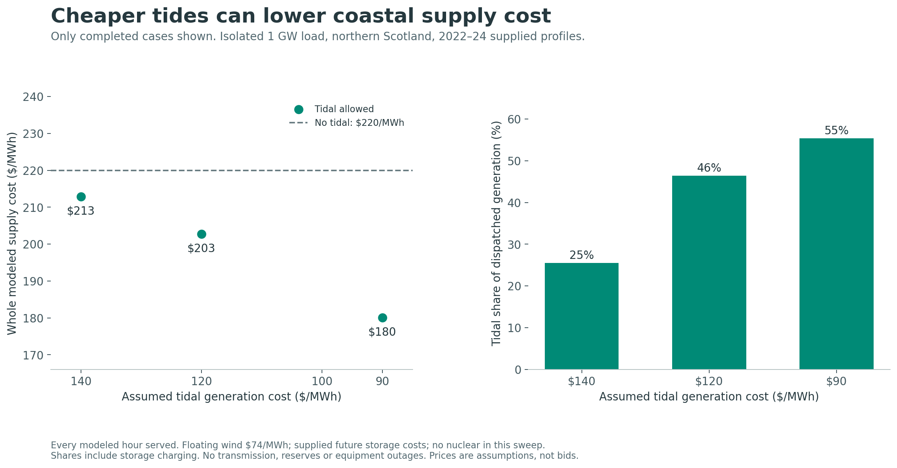
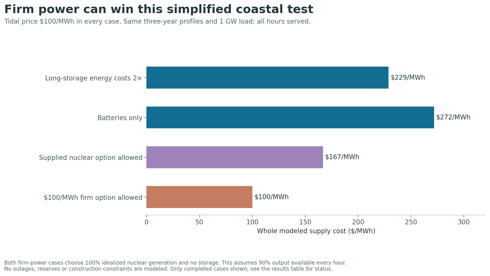

# Q3: what the checked hourly experiments say

**Tides can earn a large local role when their generation cost falls. The same model also shows why an ocean proposal should allow dependable clean generation to compete.**

**Saved outcomes: 16 optimal; 1 unsuccessful; 2 unvalidated without a saved result, out of 19 planned.** Only optimal cases support numerical conclusions. A failed solve is not evidence that a technology is infeasible.

**The batch has ended.** It exited with an assertion failure in the physical/accounting residual check. The traceback did not identify the individual case. Cases without saved results are **not validated**, rather than pending. The runner now logs future assertion failures per case and continues collecting other outcomes; no acceptance tolerances were relaxed. [Recorded batch failure](BATCH_FAILURE.json).

Each completed case supplies an isolated, constant 1 GW load in every modeled hour. Scotland and Hawaii use 26,304 hours spanning 2022–2024; separate one-year cases are identified below. These are conditional comparisons using supplied future costs, perfect knowledge of the weather, cyclic storage and no explicit equipment outages. They are not project bids, real-world reliability guarantees or a worldwide optimum. See [methods](METHODS.md), [input audit](MODEL_AUDIT.md), and the [downloadable comparison table](checked_experiments.csv).

## Tidal value in the Scottish case

Without tides, the restricted three-year system costs **$220.00/MWh**. Floating wind is priced at an assumed $74/MWh on a common reference profile. Land wind, solar, wave, batteries and longer-duration storage can also be built; nuclear is excluded in this sweep.

| Assumed tidal generation price | Whole supply cost | Saving versus no tidal | Tidal share of dispatched generation |
|---|---:|---:|---:|
| $140/MWh | $212.90/MWh | 3.2% | 25.5% |
| $120/MWh | $202.75/MWh | 7.8% | 46.4% |
| $90/MWh | $180.03/MWh | 18.2% | 55.4% |

At the assumed $90/MWh tidal price, the model builds **2.37 GW tidal**, 1.59 GW land wind, 1.26 GW solar, 3.4 GWh batteries and **161.8 GWh longer-duration storage** for the 1 GW load. It builds no floating wind or wave capacity in this case. The favorable tidal result therefore supports a mixed coastal system; it does not establish that every ocean technology belongs in its cheapest configuration.

The tidal output profile includes predictable gaps. Longer-duration storage remains substantial, and its low assumed energy-capacity cost is important. A generation share includes energy sent into storage before losses; it is not a share traced to final customers.

This is a timing benefit under the tested choices. The model has no transmission, reservoir hydro, geothermal, geographic diversity, flexible demand, reserve requirement, explicit outages or deployment/resource limits. Including those choices can alter the value of tidal generation.

## Let storage and firm power compete

- **Tidal $100; long-storage energy costs 2×:** $228.82/MWh. Tides supply 39.2%, waves 0.0%, and nuclear 0.0% of dispatched generation.
- **Tidal $100; batteries only:** $271.81/MWh. Tides supply 37.0%, waves 0.0%, and nuclear 0.0% of dispatched generation.
- **Tidal $100; wave $80:** $185.85/MWh. Tides supply 42.1%, waves 17.7%, and nuclear 0.0% of dispatched generation.
- **Tidal $100; supplied nuclear allowed:** $166.81/MWh. Tides supply 0.0%, waves 0.0%, and nuclear 100.0% of dispatched generation.
- **Tidal $100; $100 firm power allowed:** $100.00/MWh. Tides supply 0.0%, waves 0.0%, and nuclear 100.0% of dispatched generation.

**Both firm-power cases choose an entirely nuclear supply, with about 1.11 GW of capacity and essentially no storage.** The model allows 90% of nuclear capacity to operate in every hour, with no actual outages or construction limit. That strongly favors dependable generation for a flat load. These outcomes do not prove that an all-nuclear real grid is cheapest, but they do rule out claiming that the checked model established an ocean-only optimum.

The $100 firm option is a sensitivity using the same simplified nuclear cost and availability structure. It is not a verified geothermal contract or a prediction of future nuclear construction cost. The practical next comparison is an equal-service regional model with realistic outages, reserves, build limits, grids and actual project costs.

The central tidal-$100 / default-storage case has no completed optimal result in this snapshot. Do not infer its exact cost by interpolating between $120 and $90, or use the storage sensitivities to claim a measured percentage premium against that missing baseline.

## Hawaii: a separate tropical experiment

These cases cap onshore wind at 0.3 GW, allow batteries and longer-duration storage, and clip the supplied OTEC profile to its rated output. Their chosen prices are future assumptions. The original sea-temperature data has substantial imputation, documented in the audit. They do not demonstrate the performance of an operating OTEC plant.
- **Hawaii: no OTEC:** $107.00/MWh, with 0.0% of dispatched generation from OTEC.
- **Hawaii: OTEC $100:** $104.32/MWh, with 47.9% of dispatched generation from OTEC.
- **Hawaii: OTEC $90:** $98.61/MWh, with 49.2% of dispatched generation from OTEC.

## All completed cases

Generation shares include storage charging. The CSV also records losses, discarded potential output and physical residuals. Capacities are GW; storage energy is GWh. Tidal prices are USD/MWh of generation, not total supply cost.

| Case | Whole supply cost, USD/MWh | Direct marine generation | Nuclear generation | Long storage, GWh | Battery, GWh |
|---|---:|---:|---:|---:|---:|
| 2023 only; original supplied costs | 194.56 | 0.0% | 0.0% | 173.9 | 15.2 |
| Scotland: no tidal | 220.00 | 0.0% | 0.0% | 124.2 | 23.4 |
| Scotland: tidal $140 | 212.90 | 25.5% | 0.0% | 171.3 | 12.2 |
| Scotland: tidal $120 | 202.75 | 46.4% | 0.0% | 163.1 | 7.1 |
| Scotland: tidal $90 | 180.03 | 55.4% | 0.0% | 161.8 | 3.4 |
| Tidal $100; long-storage energy costs 2× | 228.82 | 39.2% | 0.0% | 121.8 | 6.9 |
| Tidal $100; batteries only | 271.81 | 37.0% | 0.0% | 0.0 | 87.2 |
| Tidal $100; wave $80 | 185.85 | 59.8% | 0.0% | 123.0 | 2.7 |
| Tidal $100; supplied nuclear allowed | 166.81 | 0.0% | 100.0% | 0.0 | 0.0 |
| Tidal $100; $100 firm power allowed | 100.00 | 0.0% | 100.0% | 0.0 | 0.0 |
| Tidal $100 reference; 40% output stress | 172.70 | 57.9% | 0.0% | 147.2 | 3.5 |
| 2010 weather: no tidal | 216.72 | 1.8% | 0.0% | 221.3 | 9.8 |
| 2010 weather + 2023 tides: tidal $100 | 162.64 | 46.0% | 0.0% | 88.8 | 3.4 |
| Hawaii: no OTEC | 107.00 | 0.0% | 0.0% | 69.5 | 13.8 |
| Hawaii: OTEC $100 | 104.32 | 47.9% | 0.0% | 26.9 | 6.4 |
| Hawaii: OTEC $90 | 98.61 | 49.7% | 0.0% | 27.3 | 6.2 |

All completed cases have zero unmet load within numerical tolerance. The 2010 stress cases pair 2010 weather with the supplied 2023 tidal sequence; they are synthetic stress tests, not historical 2010 tidal observations. The 30%/40% tidal-output cases keep the same installed-capacity cost as the central reference, so their actual generation cost changes with output.

## Solver outcomes and verification

- `scotland_3yr_tidal_100`: not validated: batch terminated with residual-validation error; individual case unattributed. No optimal cost or mix is reported.
- `scotland_3yr_marine30`: Time limit reached. No optimal cost or mix is reported.
- `scotland_3yr_tidalcf30`: not validated: batch terminated with residual-validation error; individual case unattributed. No optimal cost or mix is reported.

Across the completed cases, the largest hourly equation residual is 7.01e-12 GW; the largest constraint residual is 2.17e-10; and the largest horizon energy-balance residual is 2.63e-09 GWh. These establish numerical consistency, not real-world equipment reliability.

## Reproduce

Each case JSON contains the input hash, exact cost coefficients, output, status and physical checks. Run `python run_experiments.py --workers 2`, then `python analyze_proposal.py` and `python summarize_experiments.py`. To rerun selected cases, add `--only` and the relevant IDs to the first command. See [METHODS.md](METHODS.md) for the environment and boundaries.
