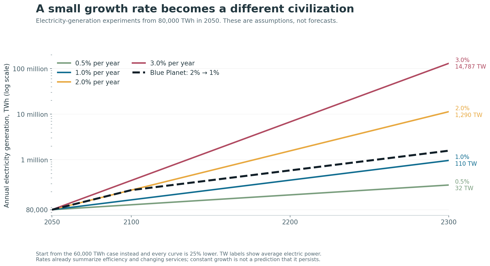
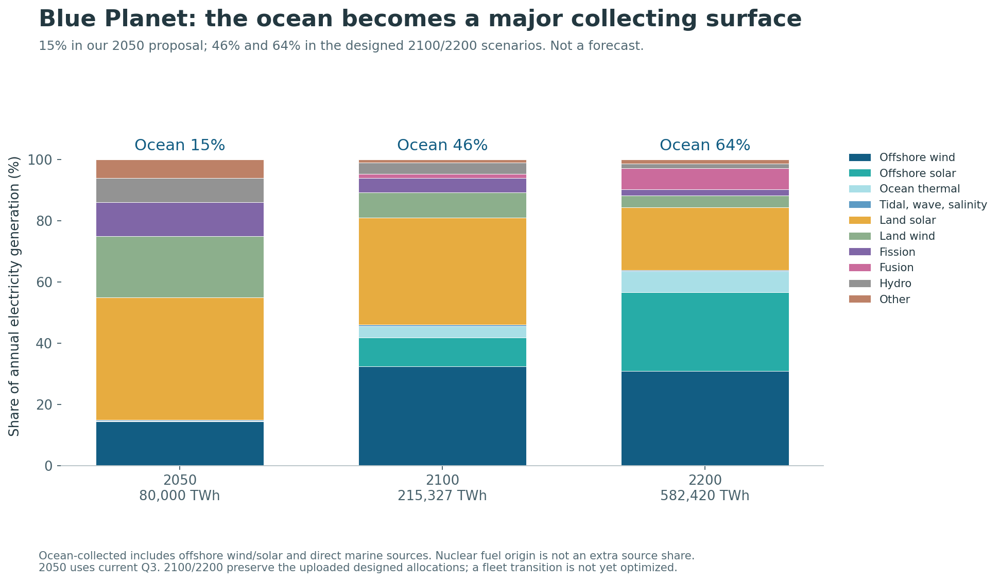
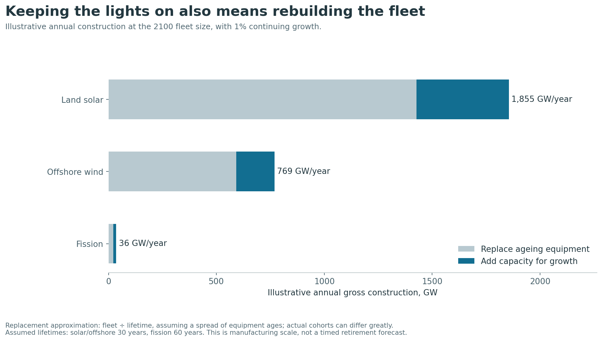
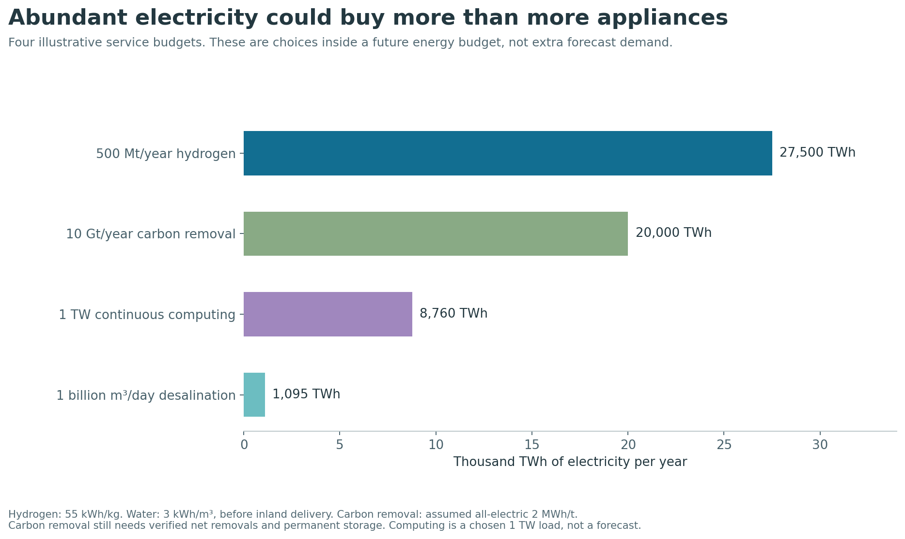
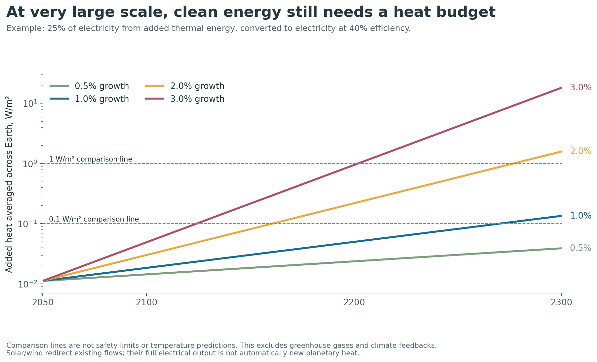
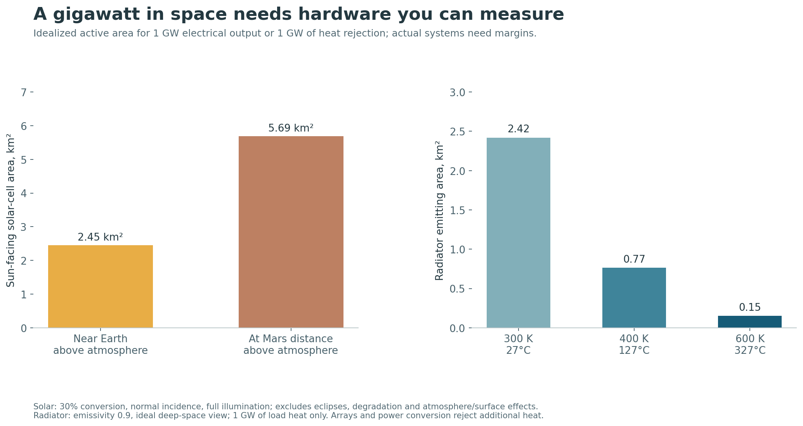

# Q4 — Blue Planet: an ocean-led energy future

**Our long-run proposal is to turn the ocean into a major place to collect, connect and use clean energy.** Start with the coastal industries in Q3. Expand offshore wind, develop solar systems that survive at sea, and test ocean thermal power where it can operate economically and responsibly. Connect those resources to land solar, fission, geothermal, storage and flexible industrial customers.

The ambitious version supplies **46% of world electricity from ocean collectors in 2100 and 64% in 2200**. These are designed scenarios from the supplied Blue Planet research, not forecasts or the result of a global cost optimization. They make the question concrete: **what would have to become true to build this world?**

## 1. Begin with what we need energy to do

Energy allows us to move things, change temperatures, make materials and transmit information. Electricity is a convenient way to deliver energy; it is not the underlying source. A solar panel converts sunlight. A turbine converts moving air or water. A reactor releases energy from atomic nuclei.

We need more electricity when more people gain access to useful services, when those services expand, and when electric equipment replaces fuel-burning machines. Better efficiency works in the opposite direction. Electrification can therefore increase electricity demand while reducing the total energy required for the same service: an electric motor avoids much of an engine's rejected heat.

The ordinary examples are concrete: more homes with refrigerators and air conditioning; factories producing more steel and other materials; cars switching from petrol to electricity; heating switching from gas to heat pumps; and more servers doing computation. For scale, **10 million electric cars using 2,000 kWh each per year add 20 TWh/year** of electricity demand. A **1 GW load running all year uses 8.76 TWh**. These are arithmetic examples, not forecasts of car counts or server demand.

Beyond basic access, an abundant future could use large amounts of electricity to make cleaner industrial materials and fuels, supply fresh water, remove carbon with verified permanent storage, support computation, or manufacture equipment in space. We should measure the service delivered, rather than assume that more energy consumption is automatically better.

## 2. The growth path: 80,000 → 215,000 → 582,000 TWh

We carry forward Q1's **80,000 TWh/year** electrified-world planning case for 2050. Blue Planet then assumes **2% annual growth to 2100 and 1% after 2100**. Neither growth rate is a prediction. The slower second-century rate represents a possible combination of mature electrification and continued efficiency gains, alongside expanding services.

| Year | Annual electricity generation | Average electrical power | Meaning |
|---|---:|---:|---|
| 2024 | 31,229 TWh | 3.57 TW | Q1's consistent historical baseline |
| 2050 | 80,000 TWh | 9.13 TW | Q1 planning case |
| **2100** | **215,327 TWh** | **24.58 TW** | 2% growth for 50 years after 2050 |
| **2200** | **582,420 TWh** | **66.49 TW** | Then 1% growth for another century |
| 2300 | 1,575,336 TWh | 179.83 TW | If that 1% growth continues another century |

One TWh is one billion kWh. One TW running continuously for a year produces 8,760 TWh. These are **generation** quantities; customer consumption is lower after the system's own uses and losses.

Growth matters enormously. Keeping 2% growth all the way from 2050 to 2200 reaches about **1.56 million TWh**, rather than 582,420. At 1% throughout, it reaches about **356,000 TWh**. At 0.5%, it is about **169,000 TWh**. These alternatives are sensitivity tests, not probabilities. Starting from Q1's lower 60,000 TWh case makes every trajectory 25% smaller. [Growth data](demand_scenarios.csv); [Blue Planet path](blue_planet_growth.csv).

The IPCC assesses multiple energy-system pathways through 2100. It does not establish one inevitable outcome, and we do not extend a published forecast to 2200 by giving our own assumptions its authority. [IPCC, Energy Systems](https://www.ipcc.ch/report/ar6/wg3/chapter/chapter-6/).

## 3. What we propose for 2100 and 2200

The supplied future allocations balance to the rounded growth totals. We retain them as the bold scenario to test:

| Source | 2100, TWh/year | 2200, TWh/year | Proposed role |
|---|---:|---:|---|
| **Offshore wind** | **70,000** | **180,000** | The largest ocean contributor; industrial-scale fleets with maintainable hardware |
| **Offshore solar** | **20,000** | **150,000** | The major new long-term bet: sunlight collected at sea |
| **Ocean thermal (OTEC)** | **8,000** | **40,000** | Tropical generation using warm surface water and cold deep water |
| Tidal stream | 100 | 110 | Predictable, concentrated regional contributions |
| Wave | 800 | 850 | Useful sites where operation and maintenance become economical |
| Salinity gradient | 300 | 440 | Electricity from the difference between fresh and salty water, where practical |
| **All ocean collectors** | **99,200 — 46.1%** | **371,400 — 63.8%** | **A location/resource subtotal; not an extra source** |
| Land solar | 75,000 | 120,000 | Large volumes of inexpensive daylight electricity |
| Land wind | 18,000 | 22,000 | Geographic and timing diversity |
| Fission | 10,000 | 12,000 | Dependable generation where complete project economics work |
| Fusion | 3,000 | 40,000 | A conditional contribution if reliable, economical plants become available |
| Hydro | 8,000 | 9,000 | Existing and suitable new sites, with storage value where reservoirs allow |
| Geothermal | 2,127 | 8,020 | Electricity and heat independent of sunshine and wind |
| **Total** | **215,327** | **582,420** | |

This is still largely a **solar-and-wind future**. In 2200, land and offshore solar together supply about 46% of the total; land and offshore wind supply about 35%. Ocean thermal and the nuclear technologies provide additional options. “Ocean” identifies an important place and collection method; it does not turn offshore solar into a different primary energy source.

**Our current 2050 proposal remains Q3's 15% ocean share**, or 12,000 TWh in its 80,000 TWh case. The uploaded draft's 10% figure and claim of a worldwide least-cost “Stage 3 result” are not used as our current conclusion. Its 2100/2200 allocations are retained as a separate long-range design. They do not yet form a solved asset-by-asset transition: for example, their tidal and geothermal outputs in 2100 are below Q3's ambitious 2050 allocations. This is a scenario difference to resolve in regional planning, not a recommendation to retire useful clean equipment early. [Q3 proposal](../question3/ANSWER.md); [upload review](UPLOAD_REVIEW.md).

## 4. What this means in actual hardware

**The key correction is that average output is not installed capacity.** A wind fleet averaging 45% of its rating needs more than twice as much rated capacity as average power delivered.

| Ocean technology | 2100 required fleet | 2200 required fleet | Planning assumption |
|---|---:|---:|---|
| Offshore wind | **17.76 TW** | **45.66 TW** | 45% average output |
| Offshore solar | **15.22 TW** | **114.16 TW** | 15% average output |
| OTEC | **1.07 TW** | **5.37 TW** | 85% average output; net electric rating |

These capacity factors are assumptions. The draft's approximately 8 TW and 21 TW wind figures were **average electrical output**, not the installed fleets. This distinction changes the construction task materially.

From Q3's upper-case 2.94 TW offshore fleet in 2050, reaching 17.76 TW in 2100 means approximately **296 GW of additional operating capacity each year**, averaged across the half-century. Going from there to 45.66 TW in 2200 adds another **279 GW/year on average**. Both exclude replacements.

At the 2100 fleet size, a simplified 30-year lifetime implies roughly **592 GW/year of offshore replacement work**. If its output share then grew with electricity demand at 1%, another 178 GW/year would be required. That illustrative total, about **770 GW/year**, is a manufacturing requirement, not a prediction of the actual retirement schedule.

This is why Blue Planet should be a story about **ports, repeatable modules, vessels, cables, repair, recycling and contracts**, as much as about turbines. We need an industry that can keep equipment working for decades and rebuild it when it wears out.

The offshore solar expansion is the largest new industrial bet. Its draft density of **12.3 W/m² of average output** implies about **186,000 km² in 2100** and **1.39 million km² in 2200**. These are around **0.051% and 0.386% of total ocean area**. Small percentages can still represent enormous operating areas. This density is an explicit scenario assumption; it is not a verified global floating-solar yield.

## 5. Why the ocean is a compelling place to try

The strongest argument combines several advantages rather than claiming one unlimited resource:

- **More places to collect sunlight and wind.** Sea-based collectors can serve regions where suitable land and local access are expensive. They must still beat the complete alternatives, including land solar and transmission.
- **Different production times.** Tides can add output during wind shortages. Q3 shows this mechanism in the supplied Scotland profiles, with its limits made explicit. It does not establish the same benefit everywhere.
- **Industrial customers at the coast.** Ports, water production and some fuel production can share infrastructure. Flexible processes can operate more during abundant supply and store a product instead of storing all the electricity.
- **An operating ecosystem that can improve with repetition.** Reusable designs, standardized connections and repairable equipment could make later fleets cheaper and more dependable.

Large open-ocean wind simulations support a substantial physical resource, but yields depend on location, scale and atmospheric response. A North Atlantic result is not a guaranteed yield across every ocean. [Possner and Caldeira, 2017](https://www.pnas.org/doi/10.1073/pnas.1705710114).

There is room for a large, useful ocean sector without assuming the sea is empty. Fisheries, ecosystems, navigation, coastal communities, security and maintenance access are part of the design.

## 6. What has to become true

| Build stage | What to establish before expanding |
|---|---|
| **Now–2050: the coastal industry** | Execute Q3's wind and tidal program; demonstrate marine solar durability; publish real availability, repair costs and delivered prices; develop ports and connections |
| **2050–2100: the Blue Grid** | Repeated far-offshore construction, large arrays with measured environmental effects, financeable marine solar, and OTEC plants whose net output and pumping losses are proven |
| **2100–2200: the ocean industrial system** | Maintain multi-terawatt fleets, connect regions, manufacture and recycle at scale, and price dependable service rather than annual energy alone |

The OTEC allocation is especially ambitious. Its 2200 output is **4.57 TW averaged across the year**. A historical study's 7 TW comparison is **not a universal “no-harm” allowance**. A newer coupled-model study finds that sustainable output depends on the climate state, deployment rate and duration. That is a research program to resolve before multi-terawatt deployment. [OTEC assessment, 2025](https://pmc.ncbi.nlm.nih.gov/articles/PMC12069477/).

The same applies to floating solar. One study modeled three North Sea settings and found limited changes in one productivity measure at lower coverage; this is not a worldwide ecological permit. Regional observations and cumulative effects must determine acceptable arrays. [Van der Molen et al., 2020](https://os.copernicus.org/articles/16/195/2020/index.html).

A system with huge annual output can still fail during a shortage. The next model therefore needs geographic resources, hourly demand, credible outages, transmission, storage, construction limits and financing. **Blue Planet's table balances annual generation; it does not yet prove hourly service or minimum cost.**

## 7. What if some of the big bets fail?

The useful version of optimism keeps alternatives available. The 2200 design includes 40,000 TWh of fusion and 40,000 TWh of OTEC. If either fails, that is a **6.9% generation gap**. If both fail, it is **13.7%**. Those are sizable but explicit replacement tasks, not a reason to abandon the entire clean-energy program.

For annual-energy scale, replacing **40,000 TWh/year** takes about **10.15 TW of offshore wind at 45% average output**, or **22.83 TW of land solar at 20%**, or **5.37 TW of fission at 85%**. These are energy-equivalent examples; their timing, land/sea use, costs and integration requirements differ. An hourly system model must choose the actual replacement mix.

If offshore solar remains much more expensive or less durable than land solar, its proposed 150,000 TWh share must move elsewhere. Shared cables and cooling are possible advantages, not proof that an offshore project is cheaper.

## 8. Abundance should buy something worthwhile

Here are four deliberately large service examples. They are **budgets inside a chosen future demand case**, not extra demand silently added on top:

| Example service | Illustrative annual electricity budget | Assumption |
|---|---:|---|
| 500 million tonnes of hydrogen | 27,500 TWh | 55 kWh/kg for electrolysis; later fuel processing and delivery are additional |
| 10 billion tonnes of carbon removal | 20,000 TWh | Hypothetical all-electric 2 MWh/tonne; not a universal measured DAC requirement |
| 1 TW of continuous computation | 8,760 TWh | A chosen load, not a compute-demand forecast |
| One billion m³/day of desalinated water | 1,095 TWh | 3 kWh/m³; inland distribution is additional |

The hydrogen assumption is consistent with present-scale system benchmarks; real future systems may differ. Water energy use depends strongly on process and location. Carbon removal also needs verified net removal, materials and permanent storage. [DOE electrolysis assessment](https://www.energy.gov/sites/default/files/2024-12/hydrogen-shot-water-electrolysis-technology-assessment.pdf), [IEA desalination](https://www.iea.org/commentaries/wired-for-water-how-electrification-is-transforming-desalination).

## 9. Beyond 2200: growth changes the engineering question

At the Blue Planet trajectory, 2300 reaches about **1.58 million TWh/year**, or **180 TW average electrical power**. We do not publish a precise 2300 generation mix: this arithmetic shows the size of the challenge, not which technologies will exist.

Two principles still apply. First, a growing system must build and replace equipment continuously. Second, useful energy ultimately becomes heat, but **its origin matters**. Solar and wind redirect existing energy flows; nuclear energy releases stored energy. Land solar shares the first property with offshore solar. Ocean collection is therefore not uniquely free of climate effects.

Our simple source-origin accounting gives about **0.029 W/m² of global-average heat from the 2200 scenario's fission and fusion**, assuming 40% electrical conversion. This is **not its total climate effect**: it excludes geothermal extraction, greenhouse gases, altered reflection, ocean mixing and regional impacts. Cooling a facility with seawater moves heat; it does not remove that heat from Earth.

The next frontier may include manufacturing and computation powered and cooled in space. It should compete on the useful service delivered. Beaming power down to Earth is a different system from producing and using it in orbit.

For **1 GW** in a favorable fully illuminated orbit near Earth, ideal solar-cell area at 30% conversion is about **2.45 km²**. Rejecting **1 GW of load heat** at 300 K and emissivity 0.9 requires about **2.42 km² of emitting radiator surface**, or 1.21 km² of ideal panel footprint if both sides have unobstructed views. A real installation needs additional structure, spacing, repair, power conditioning and heat rejection from conversion. [NASA thermal systems](https://www.nasa.gov/wp-content/uploads/2021/10/7.soa_thermal_2021_0.pdf).

On the Moon, a 1 GW constant load through an illustrative 14-day night needs **336 GWh delivered from storage** unless another source operates. On Mars, average solar irradiance above the atmosphere is about **43% of Earth's orbital value**, with surface dust and darkness adding further constraints. These conditions strengthen the case for a solar/fission combination rather than transplanting Earth's ocean portfolio. [NASA lunar study](https://ntrs.nasa.gov/api/citations/20170008159/downloads/20170008159.pdf), [NASA Mars fact sheet](https://nssdc.gsfc.nasa.gov/planetary/factsheet/marsfact.html).

The enormous far-future opportunity is real in a physical sense: at 30% conversion, intercepting one-billionth of the Sun's luminosity corresponds to roughly **115,000 TW of electricity**. It also means roughly **281 million km² of sun-facing collecting area at Earth's distance**. The meaningful leap is therefore an enormous construction and maintenance civilization, not a free source that bypasses engineering. This is a scale illustration, not a dated development prediction. [IAU solar constants](https://www.iau.org/static/resolutions/IAU2015_English.pdf).

## Our position

**Build a Blue Planet before assuming we need to leave it: collect much more sunlight and wind at sea, develop the useful marine resources, connect them to complementary clean power, and turn abundance into better services.**

The 46% and 64% ocean shares are an ambitious scenario worth testing. Its strength is the explicit growth path, equipment scale, deployment requirements and alternatives—not a claim that the ocean removes every constraint.

Read [methods](METHODS.md), [the supplied-claim review](UPLOAD_REVIEW.md), [machine-readable results](results.json), and [the source ledger](sources.json). The five original uploads are preserved unchanged in [inputs](inputs/UPLOADS.md).
